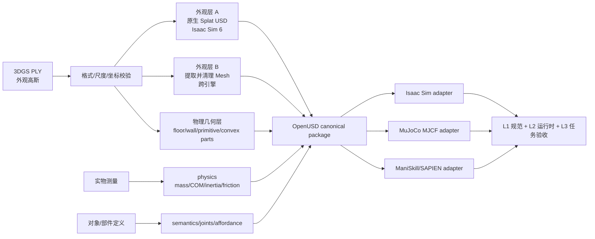

# 3DGS PLY 到 SimReady 仿真资产：MuJoCo、Isaac Sim 与 ManiSkill 工程路线

> [!summary]
> **不要把 3DGS 的 `.ply` 当作普通点云直接变成 collider。**它记录的是带位置、各向异性尺度、旋转、不透明度和球谐颜色的高斯外观表示，不天然包含闭合表面、真实尺度、质量、惯量、摩擦、语义或关节。工程上应做成“双层或三层资产”：**3DGS/mesh 负责视觉，简化 mesh/primitive 负责碰撞，独立 metadata 负责物理、语义与任务契约。**Isaac Sim 6 可把标准 3DGS PLY 转成 OpenUSD `ParticleField3DGaussianSplat` 原生渲染；MuJoCo 和 ManiSkill 的稳妥生产路线仍是传统 render mesh + 独立 collision proxy。高置信度。

## 一、结论摘要

### 1.1 最短答案



### 1.2 按目标资产类型选路线

| 资产类型 | 推荐路线 | 3DGS 的角色 | 不能省略的工作 |
|---|---|---|---|
| 静态房间、工厂、仓库背景 | Isaac 6 可原生 splat；其他引擎用 mesh/纹理烘焙 | 高保真 RGB 背景 | 地面、墙、货架、禁入区的 metric collider；导航 free-space 验证 |
| 可抓取刚体 | 分割对象 → mesh 重建/清理 → 凸分解 | 可作为视觉参考或 Isaac visual layer | 实测尺度、质量、质心、惯量、摩擦、接触面和抓取测试 |
| 门、抽屉、工具等关节物体 | 按 link 分件，另写 USD/URDF/MJCF articulation | 每个 link 的外观参考 | joint axis/limit/drive、link inertia、闭环扫关节验收 |
| 只做相机感知或 novel-view | 可直接保留 splat，物理代理做到任务所需最低限度 | 主视觉资产 | 相机标定、色彩链、深度/语义输出能力实测 |
| 接触丰富的操作、装配、插拔 | 优先 CAD/实测 mesh；3DGS 只做辅助 | 非主几何 | 毫米级关键面、间隙、摩擦、柔顺和真机 holdout |

### 1.3 三个仿真器的直接判断

| 平台 | 原生使用 3DGS 外观 | 推荐交付 | 关键边界 |
|---|---|---|---|
| Isaac Sim 6 | **可以**：PLY/SPZ → OpenUSD ParticleField | splat USD + polygonal collider USD + UsdPhysics/semantics | ParticleField 没有明确定义的表面，不能自动成为 PhysX collider；深度、语义、LiDAR 等 annotator 不能默认等价于 mesh |
| MuJoCo | **不要假设可以**；官方 USD 导入仍是实验性，未证明 ParticleField 是可用 visual/geom | OBJ/STL/MSH 或经验证的 USD mesh + MJCF + primitives/convex parts | 用户 mesh 的碰撞按凸几何处理；大场景/凹物体要拆分、heightfield 或任务化代理 |
| ManiSkill / SAPIEN | **官方常规路径不支持直接 splat** | GLB/OBJ visual + static triangle/convex collision + ActorBuilder/URDF/MJCF | dynamic actor 用凸分解；GPU 批量环境需缓存 collider 与实测吞吐 |

## 二、分类与研究边界

- **主分类**：R05 产品、平台与工具选型调研。
- **次分类**：R04 技术原理与前沿方向。
- **分类理由**：用户要把一个特定输入格式变成三类仿真运行时可用资产，需要选择表示、转换工具、canonical format、runtime adapter 和验收方法；同时必须解释 3DGS PLY 与表面/物理几何的本质差异。
- **覆盖**：静态环境、刚体道具、带关节物体；视觉、几何、碰撞、物理、语义、格式适配和 PoC 验收。
- **不覆盖**：软体/流体、完整可微渲染器开发、动态 4DGS、商业闭源工具逐项报价、未经目标硬件实测的性能数字。
- **截止日期**：2026-09-22。Isaac Sim 以 6.0 文档为当前基准；MuJoCo OpenUSD 仍明确标为实验性。

## 三、先确认输入：这个 PLY 到底是什么

### 3.1 3DGS PLY 不是普通点云

标准 3DGS PLY 常见字段包括：

```text
x y z
scale_0 scale_1 scale_2
rot_0 rot_1 rot_2 rot_3
opacity
f_dc_0 f_dc_1 f_dc_2
f_rest_0 ... f_rest_N
```

这些字段表达每个高斯椭球的位置、尺度、旋转、不透明度以及球谐辐射系数。Omniverse GSplat Converter 的官方输入合同也按这些字段识别标准 3DGS PLY。[`SRC-robotics-581`](../../../raw/robotics-embodied-ai/documents/SRC-robotics-581-omniverse-gsplat-converter-user-manual.md)

如果 header 只有 `x y z`、normal 和 RGB，它更可能是普通点云；如果字段名称、激活方式或 SH 排列来自其他实现，也可能是非兼容方言。**第一步不是转格式，而是验 contract。**

最小检查：

```bash
head -n 80 scene.ply
```

对于 binary PLY，header 仍在文件开头；正式流水线再用 `plyfile` 或 GSplat Converter parser 检查属性数量、有限值、正尺度、单位四元数、opacity 范围和 SH degree。

### 3.2 仅有 PLY 时缺了什么

| 缺失项 | 后果 | 最好补回的原始资料 |
|---|---|---|
| 相机内外参、训练图像 | 难以做纹理重投影、held-out 视觉验证和可靠重建 | COLMAP/训练 transforms、原始照片/视频 |
| 训练 config/checkpoint | SuGaR、GOF 等可能无法直接接管任意 PLY | 原训练工程、iteration、相机模型、归一化参数 |
| metric anchor | 3DGS 可能只有任意尺度 | 标尺、CAD 尺寸、LiDAR/RGB-D、已知相机基线 |
| ground/up/origin | 资产会倒置、镜像或浮空 | 采集坐标约定、地面拟合、已知重力方向 |
| object/link masks | 无法给交互对象单独配置物理和语义 | 实例/部件标注、现场对象清单 |
| 实物物性 | 不能从颜色可靠推出质量、摩擦和惯量 | 称重、尺寸、材质、斜面/推动/跌落实验 |

> [!warning]
> 如果只有一个最终 PLY，没有图像、相机、尺度和训练状态，可以做“看起来像”的 mesh 或背景，但不能承诺得到可信的抓取/接触资产。此时应把关键碰撞体重新测量或手工建模。

## 四、推荐资产架构：不要做成一个文件

### 4.1 Canonical 包建议

```text
asset_name/
├── source/
│   ├── scene_original.ply
│   ├── cameras.json
│   ├── capture_manifest.yaml
│   └── LICENSES.md
├── canonical/
│   ├── asset.usd
│   ├── appearance/
│   │   ├── splat.usdc
│   │   └── render_mesh.glb
│   ├── collision/
│   │   ├── static_environment.obj
│   │   └── convex_parts/
│   ├── materials/
│   ├── semantics.yaml
│   └── physics.yaml
├── adapters/
│   ├── isaac_sim/asset.usd
│   ├── mujoco/asset.xml
│   └── maniskill/asset_builder.py
└── evidence/
    ├── geometry_report.json
    ├── runtime_benchmarks.csv
    ├── physics_tests.csv
    └── task_acceptance.md
```

OpenUSD 适合做 canonical composition 层；但 MuJoCo/ManiSkill 仍应保留自己的 adapter，而不是要求三套引擎对同一个 USD 的解释完全一致。SimReady 资产的目标是把真实尺度、语义、非视觉传感属性和刚体物理等能力写成可验证合同，而不是“扩展名变成 `.usd`”即可。[`SRC-robotics-574`](../../../raw/robotics-embodied-ai/documents/SRC-robotics-574-simready-specification-and-physics-best-practices.md)

### 4.2 四层职责

1. **Appearance**：3DGS 或 render mesh，负责 RGB 外观。
2. **Metric/collision geometry**：负责射线、接触、占据和路径约束。
3. **Physics/articulation**：负责质量、惯量、摩擦、恢复、关节和驱动。
4. **Semantics/task**：负责 class/instance/part、affordance、spawn、goal、success/failure。

这四层可共享坐标与版本，但不应被强行合并成同一几何表示。

## 五、端到端生产流程

机器可读版见 [3DGS PLY → SimReady pipeline matrix](../../../raw/robotics-embodied-ai/data/3dgs-ply-to-simready-pipeline-matrix-2026-09-22.csv)。

### Step 0：冻结源数据和血缘

- 保存原始 PLY，不在 `source/` 上原地覆盖。
- 保存生成它的工具、版本、命令、相机模型、训练 iteration 和 config。
- 对 PLY、图像、相机文件计算 hash。
- 记录采集场地、人物、商标、设备模型和派生资产的使用/分发权限。

### Step 1：校验 PLY contract

- 区分 ordinary point cloud 与 3DGS PLY。
- 检查 Gaussian 数量、SH degree、属性长度一致性、NaN/Inf、异常大 scale、极低 opacity floaters。
- 用原生成器 viewer 与目标 converter 各渲染一组固定相机，确认坐标、四元数顺序、SH 和 activation 没有被误读。

**停止条件**：目标 converter 无法稳定复现参考视图时，不进入 mesh/physics 编译；先解决 PLY 方言。

### Step 2：恢复真实尺度和坐标

至少定义：

- `metersPerUnit`，推荐 canonical 设为米；
- up axis 与 handedness；
- asset origin/pivot；
- ground plane；
- 世界坐标到采集坐标的 4×4 transform；
- 两个以上独立实测尺寸，避免用一个错误 anchor 把整体缩放“校准正确”。

对房间可用门宽、桌高、地面控制点或 LiDAR；对物体用卡尺/CAD；对机器人周边场景还应检查相机外参与 robot base 的变换链。

### Step 3：按物理身份分割

将整体 reconstruction 分成：

- 永久静态背景；
- 可碰撞但不可动设施；
- 可移动刚体；
- articulated links；
- 玻璃、镜面、人物、车流、植物等重建不稳定或动态区域；
- 只保留视觉、不得参与碰撞的区域。

3DGS 的视觉连贯性不等于 object identity。门板、铰链、把手和墙体如果仍是同一个 splat，无法正确写关节或交互语义。

### Step 4A：Isaac Sim 6 原生 splat 外观路线

官方当前流程是把 PLY 先转为 OpenUSD ParticleField，再作为 reference 或 payload 放入 stage：

```bash
python py3dgsPlyToUsd.py \
  --input source/scene_original.ply \
  --output canonical/appearance/splat.usdc
```

也可使用 Omniverse GSplat Converter 处理 `.ply/.spz`。ParticleField 可与 polygon mesh、机器人和 RTX 光照同场渲染；但官方同时明确指出它没有 well-defined surface，阴影可能呈现模糊/团块状。[`SRC-robotics-572`](../../../raw/robotics-embodied-ai/documents/SRC-robotics-572-gaussian-splats-particle-fields-in-omniverse.md)

因此需要把 `splat.usdc` 挂在一个仅外观用途的 Xform 下，另以 polygonal prim author collider、mass 和 semantics。Isaac Sim 的 NuRec 示例本身也是在 ParticleField 环境中加载 polygonal robot，并可另加 collision ground plane。[`SRC-robotics-573`](../../../raw/robotics-embodied-ai/documents/SRC-robotics-573-isaac-sim-6-neural-volume-rendering.md)

**必须专项实测**：

- 目标 camera model、曝光和 tonemapping；
- RGB、depth、normals、semantic/instance segmentation、LiDAR/Radar 等具体 annotator；
- reflection/refraction/shadow；
- 多相机、高分辨率、Gaussian 数量下的显存与 FPS；
- splat 与 collider 在不同视角的像素/空间对齐。

### Step 4B：跨引擎 mesh 路线

#### 路线 B1：有原图、相机与兼容训练状态——首选

- **SuGaR**：先使 Gaussians 与表面对齐，再用 Poisson reconstruction 提取 mesh；可进一步得到 mesh-bound Gaussians 或传统 textured mesh。[`SRC-robotics-575`](../../../raw/robotics-embodied-ai/documents/SRC-robotics-575-sugar-surface-aligned-gaussian-splatting-official-implementation.md)
- **Gaussian Opacity Fields（GOF）**：从训练后的 3D Gaussians 建 opacity field，并以 marching tetrahedra 提取自适应 mesh。[`SRC-robotics-576`](../../../raw/robotics-embodied-ai/documents/SRC-robotics-576-gaussian-opacity-fields-official-implementation.md)

两者都更接近“在 3DGS 训练/优化链中得到表面”，不是对任意最终 PLY 的保证性转码器。

#### 路线 B2：有深度/LiDAR——通常比从 splat 反推表面更稳

- 以标定后的 RGB-D/LiDAR 融合 TSDF；
- 3DGS 只提供视觉纹理或空洞区域参考；
- 将 metric mesh 与 splat 在同一坐标系对齐。

对导航和大场景 collision，这条路线常比追求高细节 3DGS mesh 更实用。

#### 路线 B3：只有 PLY——降级方案

可尝试：高 opacity/合理 scale 筛选 → 从最小尺度轴估计 surfel normal → 表面采样 → Poisson/alpha shape → 清理。但这是**推断性重建**，容易把漂浮高斯、半透明区域和背景混入表面。只能用于低风险背景或生成初稿，不应用作精密接触的最终几何。

另一种退路是从 3DGS renderer 生成多视角 RGB/depth，再走 MVS/TSDF；它会累积 renderer depth 的系统误差，仍须实测尺度和真实扫描校核。

### Step 5：修 render mesh 与外观

原始提取 mesh 通常要做：

- 去 floaters、孤立组件和扫描噪声；
- 修洞、法线、非流形边、自交、薄片和反面；
- 分件、稳定命名、pivot、origin；
- decimation 与 LOD；
- UV 展开和纹理重投影；
- 关键轮廓/接触面保护。

**不要把球谐输出直接等同 PBR albedo。**SH 同时携带视角相关外观及采集光照；直接烘成固定 base color 会把高光、阴影或曝光写死。若需要新光照、域随机化或 RTX 传感器，应尽量从原图做材质估计，或明确标记为 `color-baked approximation`，再为 roughness/metallic/normal 和非视觉传感参数单独建层。

### Step 6：从 metric mesh 制作 collider

| 对象 | 推荐 collider | 不推荐 |
|---|---|---|
| 地面/大平面 | plane、heightfield、低模 static mesh | 几百万三角的 splat-derived mesh |
| 墙、货架、桌面 | box/capsule/少量手工 primitives 或低模 static mesh | 自动凸包把凹槽和通道封死 |
| 动态刚体 | 多 convex parts / CoACD；必要时任务化 primitives | raw non-convex triangle mesh |
| 抓取接触区 | 局部高精度 convex parts + 其余低模 | 全对象统一高精度碰撞 |
| 细线、植物、透明帘 | 通常禁碰撞或做 task-specific proxy | 逐叶片/逐线碰撞 |

MuJoCo 官方说明：用户 mesh 可按非凸形状渲染，但常规 mesh collision 使用凸几何；若需要凹物体，应预处理为多个 convex geoms。它也建议以 primitives 或充分 decimate 的 mesh 降低碰撞成本，并列出 CoACD 作为外部工具。[`SRC-robotics-577`](../../../raw/robotics-embodied-ai/documents/SRC-robotics-577-mujoco-collision-detection-and-modeling-documentation.md)

### Step 7：测量并标定物理属性

最小刚体参数：

- mass；
- center of mass；
- inertia tensor；
- static/dynamic friction；
- restitution；
- damping/rolling/torsional friction（任务需要时）；
- fixed、kinematic 或 dynamic 身份。

推荐证据：称重、悬挂/平衡质心、几何+密度初值、斜面临界角、已知推力滑移、跌落/碰撞、自由摆/关节衰减。mesh 计算的惯量只在网格闭合、尺度正确、密度假设合理时才有意义；不要从外观 PLY 直接推 mass。

### Step 8：语义、关节和 affordance

- class / instance / part 使用稳定 ID；
- 语义层与 visual/collision prim 建显式映射；
- articulated object 按 link 分割并写 joint type、axis、origin、limit、drive；
- 对操作任务补 handle、grasp region、support surface、receptacle、open/closed state；
- 对合成数据定义哪些标签来自 canonical ground truth，哪些只是模型预测。

### Step 9：编译三个 runtime adapter

#### Isaac Sim

推荐 composition：

```text
/AssetRoot
  /Appearance/Splat        # ParticleField; visual only
  /Appearance/Mesh         # optional fallback/LOD
  /Collision/...           # polygonal collision prims
  /PhysicsMaterial/...
  /Semantics/...
```

- 给 stage 写明确单位、up axis、default prim 和版本。
- Physics/semantics author 在 polygonal prim 或上层 Xform，不写在“看起来像表面”的高斯上就认为完成。
- 将 splat 与 mesh/collider 作为可切换 variant，便于性能与传感器对照。
- 用 SimReady Profile/validator 做 L1 规范门，再做 Isaac 运行时和任务验收。

#### MuJoCo

生产上仍推荐 MJCF + mesh/primitives；示意：

```xml
<mujoco model="scene_asset">
  <compiler meshdir="meshes" texturedir="textures"/>
  <asset>
    <mesh name="visual_mesh" file="render.obj"/>
    <mesh name="collision_00" file="collision/part_00.obj"/>
    <mesh name="collision_01" file="collision/part_01.obj"/>
  </asset>
  <worldbody>
    <body name="prop" pos="0 0 0">
      <freejoint/>
      <inertial mass="MEASURED_MASS" pos="MEASURED_COM" diaginertia="VALIDATED_INERTIA"/>
      <geom name="visual" type="mesh" mesh="visual_mesh"
            contype="0" conaffinity="0" density="0" group="2"/>
      <geom name="col_00" type="mesh" mesh="collision_00"
            density="0" friction="CALIBRATED_VALUES" group="3"/>
      <geom name="col_01" type="mesh" mesh="collision_01"
            density="0" friction="CALIBRATED_VALUES" group="3"/>
    </body>
  </worldbody>
</mujoco>
```

这里显式写 body inertial，避免多个 collision part 重复贡献质量；具体参数必须由资产数据生成，不能照抄占位符。MuJoCo 虽已有 OpenUSD import，但官方仍标为 experimental；“USD 能加载”不等于 `ParticleField3DGaussianSplat` 会被其 visualizer 或 physics 正确消费。[`SRC-robotics-578`](../../../raw/robotics-embodied-ai/documents/SRC-robotics-578-mujoco-openusd-importing-documentation.md)

如果强烈需要在 MuJoCo 中看到原生 splat，可做外部渲染器与 MuJoCo pose 同步的 composite viewport；但这是定制 runtime，不是便携 SimReady 资产，并且 RGB、depth、segmentation、raycast 与 collision ground truth 很容易分裂。

#### ManiSkill / SAPIEN

ManiSkill 走 ActorBuilder 或 asset dataset/URDF/MJCF loader。官方文档允许在 build 前修改 collision loading、density、friction 等属性，并提醒导入 MJCF 的属性并非全部等价，必须验证。[`SRC-robotics-579`](../../../raw/robotics-embodied-ai/documents/SRC-robotics-579-maniskill-loading-actors-and-articulations-documentation.md)

静态环境与动态物体应分开：

```python
# 示意代码：具体 API 以锁定的 ManiSkill/SAPIEN 版本为准
builder = self.scene.create_actor_builder()
builder.add_visual_from_file("render.glb", scale=[1, 1, 1])

# 静态凹场景：可使用经清理的 non-convex static collision
builder.add_nonconvex_collision_from_file("collision/static_scene.obj")
scene = builder.build_static(name="reconstructed_scene")

# 动态物体：另建 builder，使用 convex decomposition
builder.add_multiple_convex_collisions_from_file("collision/convex_parts.obj")
obj = builder.build_dynamic(name="prop")
```

对并行 GPU 环境，应预先生成并缓存 collision、AABB 和对象高度；不要在每次 reset 现场做 mesh processing。验收还要包含 `num_envs` 上的 GPU memory、physics step time、reset time 和 contact stability。

## 六、PoC 设计：先做一个背景 + 一个刚体

### 6.1 最小样本

- 1 个静态房间/工位，含地面、两面墙和一个凹形障碍；
- 1 个有真实尺寸和称重结果的刚体道具；
- 8–12 个 held-out 相机位姿；
- 1 条导航/相机轨迹；
- 1 个接触任务，如推动、放置或抓取。

### 6.2 三级验收

| 层级 | 验收问题 | 证据 |
|---|---|---|
| L1 资产规范 | 文件、单位、坐标、依赖、语义、physics metadata 是否完整 | validator JSON、dependency scan、asset hash |
| L2 运行时 | 三套引擎能否稳定加载、渲染、碰撞并达到性能预算 | load log、FPS/RTF、VRAM/RAM、collision overlay、sensor sample |
| L3 任务 | 资产是否足以支持目标导航/感知/操作任务 | 成功率、碰撞/穿透、轨迹、接触力、真实场景 holdout |

### 6.3 建议的项目阈值

以下是**PoC 建议值，不是行业标准**，应按任务容差修改：

- 关键尺寸相对误差：导航背景可先以 `≤2%`；抓取对象以 `≤1%` 或直接使用毫米绝对容差；
- ground/up/origin：无镜像、无轴翻转，放置后无可见浮空或穿透；
- collider 对齐：关键接触面距离误差小于任务 clearance 的一半；
- 物理：斜面启动角、静止姿态、跌落反弹、已知推力位移落在实测重复区间；
- 视觉：held-out camera 同时记录 RGB 指标和人工 failure tags，不只给训练视图截图；
- 性能：在目标 GPU、相机数、分辨率、`num_envs` 下达到项目设定 FPS/RTF/显存预算；
- 任务：至少一个 navigation/perception test 和一个 contact test；运行次数在测试计划中预注册，不能看到结果后再改门槛。

### 6.4 必做负面测试

- 相机进入训练视角外或靠近表面；
- 强逆光、反射、透明区域；
- 机器人紧贴墙/桌边，检查视觉表面与 collider 偏移；
- 动态物体高速旋转/跌落，检查凸分解稳定性；
- Isaac 中关闭 splat，只看 collision/semantic overlay；
- 三引擎加载同一 canonical version，读取并比对尺度、AABB、mass 和初始 pose。

## 七、常见失败与诊断

| 症状 | 根因 | 修复 |
|---|---|---|
| PLY 能看，但 converter 颜色/形状错误 | 不是标准字段、SH 排列/激活/四元数顺序不同 | 固定生成器版本，写 dialect adapter，并用固定相机回归 |
| 机器人看似在地上却穿地 | splat 只有外观，没有 collider，或两层 transform 不一致 | 独立 ground/collision USD/MJCF/ActorBuilder，并做 overlay 对齐 |
| MuJoCo 凹槽被封死 | mesh collision 被凸包化 | CoACD 拆成多个 convex geoms 或改用 primitives/heightfield |
| ManiSkill 动态对象爆炸/抖动 | dynamic non-convex mesh、质量/惯量错误、初始穿透 | 凸分解、显式物理参数、spawn clearance 和 timestep 检查 |
| 新光照下纹理像“贴死的照片” | SH/采集光照被当作 PBR albedo | 从原图做材质分解，或标注 baked-lighting 限制 |
| RGB 很逼真，depth/semantic 不可信 | visual splat 与 polygonal ground truth 不一致 | 单独验证每个 sensor/annotator；必要时切 mesh variant |
| 资产在一个引擎可用，另一个错位 | 单位、up axis、handedness、pivot 或 quaternion 约定漂移 | canonical transform + adapter transform 单元测试 |
| mesh 抽取满是薄片和洞 | 3DGS 优化目标是渲染，不是表面 | 回到图像+深度/GOF/SuGaR 重训，或人工重建关键几何 |

## 八、方案选型

| 条件 | 推荐 | 不推荐 |
|---|---|---|
| Isaac Sim 6，主要做 RGB 感知/展示 | 原生 ParticleField + 简化 collider | 先强制把 splat 全部烘成 mesh 再丢失视觉优势 |
| 三引擎必须共享 | OpenUSD canonical + render mesh + collision mesh + per-engine adapter | 指望一个 PLY 或一个 USD 文件零适配通吃 |
| 目标是导航/避障 | LiDAR/RGB-D/CAD 做 metric collider，3DGS 做背景 | 用视觉 floaters 定义 free space |
| 目标是抓取/装配 | 对象重扫/CAD/实测，3DGS 只辅助纹理 | 从场景 splat 自动切出后直接用于接触 |
| 只有 PLY | 先做低风险静态 PoC，关键 collider 人工/测量重建 | 声称得到物理可信数字孪生 |
| 有完整训练数据 | SuGaR/GOF 与 TSDF/MVS 做 A/B，按任务误差选 | 只按 mesh“看起来更细”选工具 |

## 九、商业应用可能性

### 9.1 谁会买、买什么

| 角色 | 痛点 | 可收费交付物 |
|---|---|---|
| 机器人算法/仿真团队 | 真实场景重建快，但 3DGS 不能直接做碰撞/任务 | 版本化场景包、三引擎 adapter、任务验收报告 |
| 工厂/仓储集成商 | CAD 与现场不一致，改造前验证成本高 | as-built visual + metric collider + 路线/视场/干涉测试 |
| 合成数据团队 | RGB 逼真但标签、depth、physics 不一致 | sensor-qualified asset variants、标注和回归基线 |
| 机器人本体/抓取团队 | 物体长尾、SKU 更新快 | 交互对象 mesh/collider/physics/affordance 包 |

### 9.2 成熟度判断

- **3DGS 作为 Isaac Sim 6 视觉场景**：已进入官方产品能力，近期商业可用性中高；仍需资产/传感器级验证。
- **3DGS 自动变成跨引擎物理可信资产**：仍是工程组合与 PoC，成熟度中低。
- **结构化工厂/仓储的 Real2Sim 服务**：近期最可落地，因为地面、墙、货架和工位可测量，任务边界清楚。
- **精密装配、软体、透明/镜面物体**：中期仍需 CAD、专用传感和人工技术美术/物理标定。

近期 1–2 年，最现实的是“视觉复刻 + 低模物理代理 + 任务验证”的项目交付；3–5 年若 SimReady Profiles、OpenUSD ParticleField、材质/传感器标准和自动物理标定成熟，资产复用与自动 QA 比例可提升。置信度中等。

## 十、中小型创业者的机会

### 10.1 可立即验证

| 切口 | MVP | 首批客户 | 首个收费交付 |
|---|---|---|---|
| 3DGS → 三引擎资产编译器 | 一个房间+一个刚体，生成 USD/MJCF/ManiSkill 包 | 机器人实验室、仿真团队、集成商 | 资产包 + validator + 任务报告 |
| collider/physics QA | 对现有漂亮资产做 scale/collision/mass/friction 审计 | 资产库公司、合成数据团队 | 问题清单 + 修复包 + 回归测试 |
| 垂直场景 Real2Sim | 仓库货架、配电房、实验室工位 | 巡检、AMR、机械臂方案商 | 场景包 + 路线/视场/碰撞用例 |
| 传感器一致性验证 | 比较 splat/mesh 的 RGB-depth-semantic-LiDAR 输出 | 视觉/VLA/导航团队 | 数据差异报告 + qualified variants |

典型团队可从 2–4 人起步：3D 重建/图形、技术美术/USD、机器人仿真/测试；资金需求低到中，首个限定 PoC 可按 4–8 周设计，但不能在没有实测前承诺固定周期或成本。

### 10.2 需要条件成熟

- 自动从 splat 分解可动 link、推断 joint 与物理参数；
- 跨引擎统一传感器材质；
- 大规模可复用资产市场与 profile certification；
- 基于真机失败回流的自动 collider/physics 更新。

这些方向需要客户现场数据、稳定标准和任务级 benchmark，不宜只靠通用模型演示。

### 10.3 不建议进入

- 只卖“一键 PLY 转 SimReady”的无边界承诺；
- 与 NVIDIA 直接竞争通用 3DGS renderer/格式转换；
- 没有场景授权就销售扫描资产；
- 仅按截图验收、不承担碰撞/传感器/任务质量；
- 直接做通用高精度材质反演、关节发现和物性推断全栈，资本与研发跨度过大。

可形成的护城河不是单次 mesh 转换，而是：垂直场景 schema、物性测量 SOP、任务失败库、跨引擎回归、客户资产 registry 和持续版本维护。

## 十一、事实、判断、假设与反方证据

### 11.1 事实

- Omniverse 当前可把标准 3DGS PLY 转 OpenUSD ParticleField 并原生 RTX 渲染。[`SRC-robotics-572`](../../../raw/robotics-embodied-ai/documents/SRC-robotics-572-gaussian-splats-particle-fields-in-omniverse.md)
- ParticleField 没有 well-defined surface；这直接限制其作为 collider 的能力。[`SRC-robotics-572`](../../../raw/robotics-embodied-ai/documents/SRC-robotics-572-gaussian-splats-particle-fields-in-omniverse.md)
- SuGaR 与 GOF 提供从兼容的 3DGS 训练/优化流程提取 mesh 的研究实现。[`SRC-robotics-575`](../../../raw/robotics-embodied-ai/documents/SRC-robotics-575-sugar-surface-aligned-gaussian-splatting-official-implementation.md) [`SRC-robotics-576`](../../../raw/robotics-embodied-ai/documents/SRC-robotics-576-gaussian-opacity-fields-official-implementation.md)
- MuJoCo 对用户 mesh 的常规 collision 使用凸几何，并建议凸分解/简化。[`SRC-robotics-577`](../../../raw/robotics-embodied-ai/documents/SRC-robotics-577-mujoco-collision-detection-and-modeling-documentation.md)
- ManiSkill custom asset 路线可分别管理 visual、collision、density 和 friction。[`SRC-robotics-579`](../../../raw/robotics-embodied-ai/documents/SRC-robotics-579-maniskill-loading-actors-and-articulations-documentation.md)

### 11.2 工程判断

- OpenUSD 应作为 canonical package，而不是要求所有 runtime 直接吃同一 geometry prim。
- 对三引擎共享，render mesh + collision proxy 是最低公分母；Isaac 再增加 splat visual variant。
- 对接触任务，重测关键几何通常比继续优化 splat-to-mesh 更划算。

### 11.3 假设

- 假设用户拥有原始图像/相机或至少一个真实尺度 anchor；否则报告中的高质量 mesh 路线会退化。
- 假设目标是刚体机器人仿真；软体、布料、液体需要独立模型。
- 假设资产分发权可确认；真实场景扫描可能涉及隐私、商业秘密与商标。

### 11.4 反方证据与知识冲突

- **“Isaac 已原生支持 3DGS，所以 mesh 不再需要”**：只对视觉渲染成立；官方 ParticleField 文档自己说明没有明确定义表面，Isaac 示例也可另加 collision ground plane。
- **“MuJoCo 已支持 USD，所以可直接用 splat USD”**：USD import 只说明容器/场景解码能力，且仍属实验性；未发现官方声明 MuJoCo visualizer/physics 支持 ParticleField。
- **“SuGaR/GOF 能从 PLY 得到 mesh，所以可以一键生产”**：官方流程包含专用 regularization、训练状态、相机与后处理；提取 mesh 仍不等于 watertight、metric、PBR、collision 或 physics-ready。
- **“视觉越真实，sim-to-real 越好”**：对接触、导航 free-space 和非视觉传感器未必成立；错误 collider 或材质参数可能让逼真图像掩盖更大的任务偏差。

## 十二、风险、证伪条件与监测指标

| 风险 | 证伪/停止条件 | 监测指标 |
|---|---|---|
| 几何不可用 | 关键面误差持续超过任务 clearance，且重建路线无法收敛 | anchor error、Chamfer/point-to-plane、collision clearance |
| 视觉过拟合训练视角 | held-out 路径出现 floaters、孔洞、曝光跳变 | PSNR/SSIM/LPIPS + failure tags |
| 物理不可信 | 斜面、跌落、推动或关节响应无法进入实测区间 | mass/COM/inertia provenance、friction test residual |
| 性能不可接受 | 目标相机/并行环境下持续超显存或低于 RTF/FPS 门槛 | Gaussian/triangle/convex counts、VRAM、step time |
| 跨引擎漂移 | AABB、scale、pose、mass、contact outcome 超出预设容差 | adapter diff、task trajectory diff |
| 标准/版本漂移 | Isaac/MuJoCo/ManiSkill 升级后 import 或 schema 行为变化 | pinned versions、validator history、nightly regression |
| 许可/隐私 | 无法证明采集与派生分发权 | license manifest、scene release form、redaction log |

## 十三、待验证事项与下一步

1. 用用户的实际 PLY 跑 header/字段/数值分布审计，确认生成器方言。
2. 确认是否保留原始图像、相机 poses、训练 checkpoint、真实尺度 anchor 和对象清单。
3. 在 Isaac Sim 6 验证 PLY → ParticleField，并逐项测试目标 RGB/depth/semantic/LiDAR 输出；当前报告只证明官方能力入口，不证明用户数据集表现。
4. 对同一场景用 SuGaR、GOF、RGB-D/TSDF 至少做两路 mesh A/B；按任务区域几何误差与清理工时选，不按截图选。
5. 选一个可称重刚体，完成 CoACD、三引擎 adapter 和推动/跌落/抓取闭环。
6. 固定运行时版本、GPU、分辨率、相机数、`num_envs` 和验收门槛，再测性能。
7. `SRC-robotics-580` 自动抓取失败；若 SAPIEN API 细节影响实现，应从新版文档域或固定提交源码补齐 durable artifact。

## 十四、来源与证据质量

- 本报告主要使用 S 级官方文档、官方仓库和作者实现，汇总见 [[_sources/3dgs-ply-to-simready-source-set|来源集]]。
- Isaac/Omniverse、MuJoCo、ManiSkill 文档支持格式和运行时边界；SuGaR/GOF 支持研究路线，但其作者结果不等于用户场景 benchmark。
- 既有总论：[[3d-simulation-asset-production-pipelines-comparison-2026-08-06|3D 仿真资产生产技术管线综合调研]]。
- 通用验收表：[SimReady 验收清单 CSV](../../../raw/robotics-embodied-ai/data/simready-acceptance-checklist-2026-08-06.csv)。

## 关联连接

- [[_sources/3dgs-ply-to-simready-source-set|3DGS PLY 到 SimReady 来源集]]
- [[3d-simulation-asset-production-pipelines-comparison-2026-08-06|3D 仿真资产生产技术管线综合调研]]
- [[isaac-sim-vs-gazebo-vs-mujoco-2026-07-14|Isaac Sim vs Gazebo vs MuJoCo 机器人仿真平台选型]]
- [[_syntheses/bilibili-panogs-slam-panoramic-3dgs-deep-dive-2026-09-19|PanoGS-SLAM 全景 3DGS-SLAM 深研]]

## 2026-11-09 增补案例

- [[news/2026-11-09-3dgs-robot-simulation-data-real2sim-vlk|Niantic/Flexion 与 VLK 文章核验]]：外观和碰撞几何分层在场地导航中的应用；VLK 将合成全身轨迹与第一人称渲染配对。保留特定场景、公司/作者披露和零样本实验边界，不改变本文对物性与真机验收的要求。

## 2026-11-10 VLK 案例增补

- [[robotics-embodied-ai/research-notes/vlk-synthetic-data-zero-shot-project-fit-2026-11-10|VLK 合成监督流程与工程适配]]：人工场景标注、运动先验、运动学后处理与配对渲染分开审计；MuJoCo执行/Isaac渲染有论文先例，但不证明现有项目已完成对接。

## 知识冲突：2026-11-10 MuJoCo OpenUSD 能力更新

2026-09-22本文以当时版本提出传统mesh与MJCF路径。本轮核查的MuJoCo stable已记录实验性USD/USDZ导入，前提是构建启用USD；不能再把“MuJoCo完全不能读USDZ”作为永久结论。该更新不等于支持Niantic NuRec神经外观或证明当前固定项目构建/碰撞/性能通过，仍需验证。参见 [[robotics-embodied-ai/research-notes/niantic-flexion-real2sim-zero-shot-project-fit-2026-11-10|Niantic／Flexion适配报告]] 与 [官方导入文档](https://mujoco.readthedocs.io/en/stable/OpenUSD/importing.html)。原始日期判断保留。

新增资产证据：公开Pondicherry NuRec包内确有外观/mesh分层及碰撞标记；局部mesh近50万面，转换后碰撞表示与性能仍待测，不能据文件存在声称SimReady验收完成。
