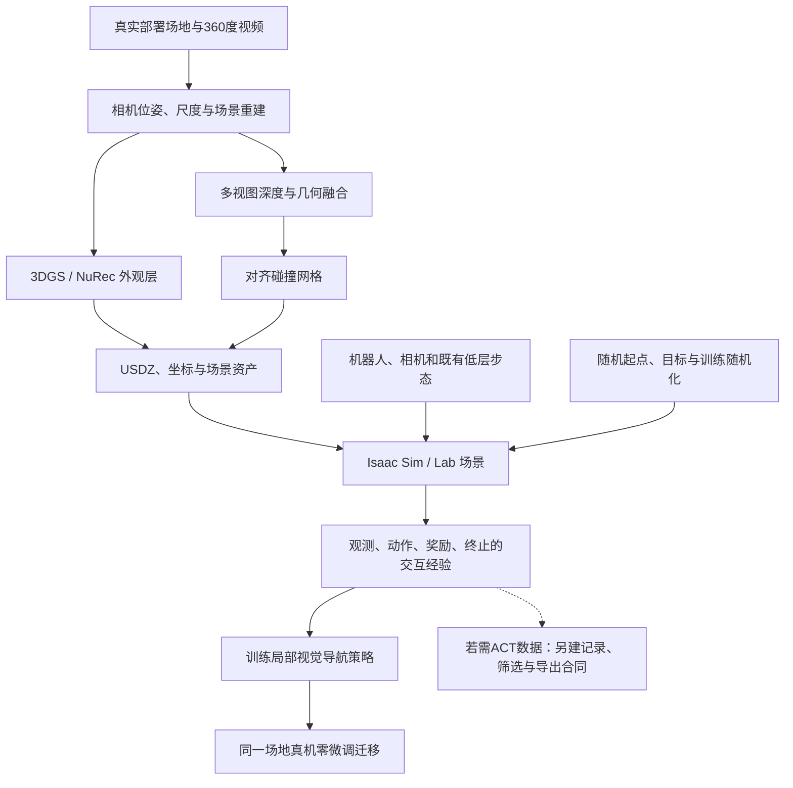

# Niantic／Flexion 工作流深研

## 结论摘要

1. **值得把 Niantic 当作候选场景资产/重建服务，不能把它当作现成 ACT 数据生成器或完整开源机器人训练栈。置信度高。**公开交付物是带神经外观和对齐碰撞网格的场景；Flexion 在场景内训练导航策略，产生在线仿真交互经验。未找到该合作入口发布的导航策略权重、完整训练代码、随机化配置和可复用观测—动作轨迹包。
2. **零样本证据限于已重建场地的局部导航迁移。置信度高。**两办公室的量化结果是仿真；真机公开材料以演示和定性结论为主。它不证明完全未知建筑、通用抓取或长程任务已获得同样成功率。
3. **Microduck 更适合借鉴其控制分层，SO-101 更适合把它作为视觉资产层候选。置信度中。**前者可研究 RGB/目标→速度命令→既有步态；后者仍需自己的教师、动态杯子、夹爪与接触模型、因果采样和 ACT 数据导出。
4. **公开样例确实包含碰撞资产，已做局部文件静态核查；尚未验证渲染或物理运行。置信度高。**一个 Pondicherry NuRec USDZ 内含 `default.usda`、`sim.nurec`、`gauss.usda`、`mesh.usd`。抽取网格有259,296点、499,999面，碰撞启用、渲染隐藏。不能因资产可下载就认定适配当前MuJoCo/MJWarp或抓杯任务。
5. **建议从免费样例和同预算对照开始，暂不据营销时间/费用承诺采购或迁移全部引擎。置信度中高。**评估价值的最终指标是留出场景闭环成功率、真实时间稳定性、人工适配工时和总成本；图像逼真、场景数量或仿真成功率单独都不够。

> [!warning] 本轮完成范围
> 已完成一级资料核阅、公开基准脚本数据提取、固定提交代码检查、样例USDZ局部读取/静态网格解析，以及本机项目文件哈希复核。未完整下载神经场景包、未运行Isaac/MuJoCo物理或渲染、未训练/部署策略、未访问ai-station、未上传场地数据、未联系供应商或购买服务。

## 分类、研究边界与证据

- **主分类 R05，次分类 R04／R07**。决策对象是能否把商业重建/场景资产接入现有机器人项目；需解释机制并核对迁移实验与商业交付真实性。
- 前驱微信材料的主张包括：360°采集、3DGS与碰撞几何、97.8%仿真成功率、真机零样本迁移。本轮从双方官方联合发布、产品页、固定版本文档和实际样例检查展开，不将微信伪代码当作官方实现。
- 截止2026-11-10。Niantic/Flexion博客与产品主张按A级公司披露；代码、原始资产、数据卡、文档和本地源码快照按S级一级技术资料。两个合作方复述同一次实验不算独立复现。
- 当前实现依据分别标明：2026-07-20联合发布、HF固定revision、MVSAnywhere固定commit，以及Isaac Sim **6.2.0**文档。后来的工具能力不能倒推成7月实验的精确版本/配置。
- 来源集：[[_sources/niantic-flexion-workflow-source-set-2026-11-10|20项来源与捕获状态]]。正文使用可点击的SRC编号；“事实”指资料披露或本轮静态检查结果，“判断/建议”指本轮分析，不是测得性能。

## 一、谁提供哪一部分

| 参与者 | 已披露职责 | 没有据此证明的能力 |
|---|---|---|
| Niantic Spatial | 从实景采集恢复外观、尺度/坐标和碰撞代理，交付重建资产 | 自动识别全部可操作物体、真实质量/摩擦、直接生成抓杯示教 |
| Flexion | 视觉导航策略、随机化和预训练编码器、低层运动控制与部署软件 | 合作演示的全部权重/训练配方已公开，或原策略能跨本体直接使用 |
| NVIDIA | Isaac Sim/Lab、NuRec/RTX/OpenUSD等基础设施 | 平台支持等于Niantic商业服务或Flexion策略开源 |

联合示范的可观察任务是 **local navigation**：当前机载视图、本体状态、机体坐标中的附近目标，输出速度指令；另一套在环预训练步态控制器把速度变成运动。局部策略不依赖预先构建的全局地图，但目标从哪里来、怎样估计机体/目标坐标，仍需要外围系统；不能解释为“整个机器人不需要定位或任务规划”。[SRC-robotics-689]、[SRC-robotics-706]。

## 二、合成数据生成到底是什么

这里应区分三个交付层次：

1. **重建世界资产**：从真实采集形成可渲染外观和碰撞几何。
2. **仿真交互经验**：机器人在这个世界里观察、行动、接触、得到奖励与终止信号，供强化学习更新策略。
3. **可交付训练数据集**：定义好相机/状态/动作/时间戳/结果/schema、筛选并导出的episode包。公开合作资料没有提供这一层的完整产品或下载物。

Hugging Face把样例标为dataset、`train` split显示8行，含义是**8个场景资产条目**，不是8条机器人episode，更不是VLK式48k配对轨迹。[SRC-robotics-691]、[SRC-robotics-692]。

### 2.1 从相机到仿真资产

实线依据联合发布的公开步骤，虚线是我们的工程需求，并非其已发布功能。

### 2.2 采集、位姿与尺度

**公司披露**：使用普通360°相机步行数分钟，无需LiDAR/三脚架，估计相机位姿并形成公制场景；场景外观保留采集时照明、材质与杂物。[SRC-robotics-689]。

**未披露到可复现的内容**：具体相机/镜头、采样与曝光、位姿求解器、尺度标定来源、弱纹理失败处理、几何误差测量与覆盖要求。因此不能沿用微信文章“根据步行速度自动恢复绝对尺度”的解释。

MVSAnywhere的官方方法说明：输出深度处于**输入相机位姿的尺度**；固定源码示例也要求当前/参考图像、相机位姿和内参。它能估计有效深度范围，不等于从任意无尺度单目视频凭空获得准确米制尺度。[SRC-robotics-693]、[SRC-robotics-694]、[SRC-robotics-703]。

对我们的验收：门宽、地面高度、桌面和杯子的基准尺寸应另有实测对照；相机覆盖不到的角落、不稳定动态物体、反射/透明结构不能由“照片级”一词替代检查。

### 2.3 外观与碰撞的双层生成

公司称同一重建同时产生Gaussian外观与碰撞网格，深度环节包括MVSAnywhere，减少两套独立重建交叉配准误差；网格作为不可见物理代理，NuRec经RTX渲染RGB。[SRC-robotics-689]。

MVSAnywhere公开实现提供多视图深度、网格融合示例，以及用深度正则约束Gaussian训练的`regsplatfacto`。这能帮助理解组件，但**没有证据表明其公开demo参数就是Niantic商用后端或本次Flexion实验的全部配方**。微信示例中的2cm体素、30k训练步、ResNet50、手写奖励权重、虚构`NuRecVolume`类名都不应升级成官方参数。[SRC-robotics-694]、[SRC-robotics-703]。

“对齐”也应拆开看：共用位姿/坐标减少相对错位，但仍可能存在共同的尺度误差、缺失几何、玻璃/薄结构误建、动态物体冻结或表面物性错误。同一重建不保证物理地面真值。

### 2.4 USDZ打包与静态世界的边界

交付被描述为重力对齐、公制、collider-ready的NuRec USDZ；Isaac可加载其外观和物理代理。但扫描捕获的是一个时刻：照明、反射和物体位置被烘入；人、机器人等动态体需后加，未覆盖处质量更低。[SRC-robotics-689]。

这意味着：扫描中一只杯子如果只是静态背景的一部分，不能直接变成可被夹爪拿走的动态杯子。需移除或遮掉静态外观/碰撞残影，再加入独立几何、质量/惯量、接触材质、关节（如有）与观测一致的动态对象。背景、目标物和机器人必须在同一坐标/时间链中。

### 2.5 从仿真场景到训练经验

公司公布的循环是：

1. 在重建场地中采样机器人起点与目标；加载本体与相机。
2. RGB＋本体感知＋相对目标进入导航网络，输出速度命令。
3. 在环的预训练步态策略执行；物理引擎更新状态和碰撞；相机产生下一帧观察。
4. 以接近/到达目标、避障等奖励和碰撞/跌倒惩罚训练导航策略；配合仿真参数随机化和离线预训练视觉特征。
5. 在同一个部署场地数字副本中进行大量并行rollout，再把策略送回真实场地。

以上为工作流级描述，不足以还原训练器。[SRC-robotics-689]、[SRC-robotics-706]。

**重要缺口**：优化算法和超参数、actor/critic schema、视觉骨干/数据及冻结方式、环境数、渲染分辨率、相机时序、物理/控制频率、随机化范围、奖励数值、episode时长/终止协议、训练GPU型号/显存、准确rollout数、checkpoint与统计脚本均未充分公开。不要将“使用Isaac Lab”自动等同于某版PPO配方。

“单GPU大规模并行、小时级训练、百万rollout”是作者概括，不是本轮复测吞吐。公开评测中的1,024次是**每个评测条件的rollout数**，不是训练数据规模。渲染、物理、模型与存储共享GPU/带宽资源；实际容量必须按目标相机数量/分辨率/场景测量。

### 2.6 若我们要导出 ACT 数据，还缺什么

RL经验中可能有探索、碰撞、摔倒与随机目标，不能全部当成成功专家示教。至少要另行确定：

- 观测相机、状态、动作的定义与单位；动作是速度、关节reference还是运动学轨迹；
- 按哪一个时间网格因果配对，哪些量只能作为教师/审计真值；
- 数据筛选、失败标签、源轨迹族、场地/布局split、不可变版本与导出格式；
- 对应任务物理结果和闭环评测，而非只保存导航奖励；
- 如果采用离线重渲染，记录完整动态状态与相机变换，不能仅凭计划路径补造观察。

这些是新增研究/工程要求，**没有证据显示购买场景或下载样例就附送完整ACT数据集与训练流程**。

## 三、公开资产与实现实际开放到哪一层

### 3.1 四个地点、八个资产变体

HF固定revision：`f7ca59406bf15cdaf28e9c95bb99a317ebd7c83c`，数据卡标CC-BY-4.0。NuRec Volume Schema四个USDZ被推荐为初始评估入口；Particle Field Schema是同四场景的另一表示，不是额外四个独立场景。[SRC-robotics-691]、[SRC-robotics-692]、[SRC-robotics-702]。

| 场景 | NuRec Volume包实际bytes | 仓库元数据尺寸标签 | Particle Field变体 |
|---|---:|---|---|
| Bastille Place | 1,479,477,623 | 1.38 GB | USDC，约2.92×10⁹ bytes |
| Judah | 1,258,203,927 | 1.17 GB | USDC，约2.49×10⁹ bytes |
| Pondicherry | 281,508,778 | 268.5 MB | USDZ，553,898,003 bytes |
| Tokyo Street | 1,204,065,184 | 1.12 GB | USDC，约2.38×10⁹ bytes |

尺寸标签近似采用二进制量级但写作MB/GB；容量核算用API原始bytes。部分Particle Field文件的真实路径带`-001/-004/-002`等后缀，而metadata.csv省略它们，下载脚本应以实际tree为准。完整路径及advertised LFS哈希见[资产清单](../../../raw/robotics-embodied-ai/data/niantic-sample-assets-inventory-2026-11-10.csv)。

这四个地点不等于实验的苏黎世/伦敦办公室，不应把下载样例当完整复现实验资产。商业Places Library页面声称有100个场景，另列两项免费样例；它与HF四地点公开样例也不是同一清单。[SRC-robotics-700]。

### 3.2 本轮实际检查了什么

对较小的Pondicherry NuRec包做HTTP Range读取：ZIP尾目录和三个小成员，**没有完整下载约281.5MB场景包**。成员内容CRC32已核对并记录各自SHA256，完整包的LFS SHA256仅来自API，未本地核验。三个成员共约4.59MB，外加目录/头数据。[SRC-robotics-702]。

| 文件 | 静态结果 | 不能据此宣称 |
|---|---|---|
| `default.usda` | 根stage明确`metersPerUnit=1`、Z-up、defaultPrim World | 已与实景尺寸比对通过 |
| `gauss.usda` | Volume/OmniNuRecFieldAsset引用`sim.nurec`，关联mesh与局部变换 | 已在RTX看到正确图像或视觉/碰撞无误差 |
| `mesh.usd` | 259,296点、499,999面；PhysicsCollisionAPI/PhysicsMeshCollisionAPI；collisionEnabled=True、approximation=none、visibility=invisible | 适合当前MuJoCo/MJWarp的接触与吞吐，或包含杯子摩擦/真实动力学 |
| `sim.nurec` | ZIP目录报告276,917,543 bytes | 未下载、未解码或渲染，不能评价重建质量 |

用OpenUSD 0.26.11解析了孤立mesh层。其`metersPerUnit=0.01`/Y-up是**未显式写入时的fallback**，根stage才写明1米/Z-up，并带组合变换；不能据fallback制造“资产有100倍尺度错误”的结论。应保留完整composition再检查尺寸和朝向。只读解析时出现OpenUSD架构假设warning，但解析完成；这不构成物理验收。

当前部分成员目录不是完整可渲染场景。我们只证明了资产结构和碰撞标记的存在，尚未证明重建精度、可行走区域、接触稳定、对齐质量或GPU性能。

### 3.3 三类开放性必须分开

- **可下载场景**：HF样例及其数据卡，具备静态资产评估入口。
- **公开研究组件**：MVSAnywhere有固定提交源码、权重入口、深度/融合示例；其README与LICENSE明确为非商业使用条款，不能把它等同于任意商业开源组件。[SRC-robotics-694]、[SRC-robotics-695]。
- **端到端商用链路**：未从联合发布及其公开链接取得Niantic完整商用重建后端，或Flexion该导航策略的完整训练代码/权重/部署包。MVSAnywhere、Isaac例程和场景文件拼在一起并不等于精确重现论文级实验。

场景CC-BY、MVSAnywhere软件条款、NVIDIA软件/模型条款、定制场地合同是不同层；以各自产物和协议为准。此处记录公开文本，不替代具体项目授权核实。没有因本次研究发起任何第三方联系或接受新合同。

## 四、零样本迁移的实验边界

### 4.1 可复核的仿真基准

联合发布说明：两办公室、四种策略；每策略每场景1,024次评测，复用相同spawn/goal；记录成功、120秒超时和跌倒。四组同时改变视觉模态/训练环境，不能把全部组间差异解释成仅RGB与深度的传感器消融。[SRC-robotics-689]。

本轮从官方HTML的`var SCENES`提取了图表数据，比仅阅读正文多得到完整失败分布。下表按网页显示口径保留一位小数；CSV同时保存发布的小数原值，不用近似小数反推精确成功次数。

| 场景 | 条件 | 成功% | 超时% | 跌倒% |
|---|---|---:|---:|---:|
| Flexion office | RGB / Niantic 3DGS | 97.8 | 0.2 | 2.1 |
| Flexion office | Depth / generated mesh | 93.8 | 0.9 | 5.4 |
| Flexion office | RGB / synthetic office | 70.7 | 2.2 | 27.1 |
| Flexion office | RGB / generated mesh | 71.7 | 22.2 | 6.2 |
| Niantic office | RGB / Niantic 3DGS | 75.0 | 16.0 | 9.0 |
| Niantic office | Depth / generated mesh | 70.9 | 17.7 | 11.4 |
| Niantic office | RGB / synthetic office | 53.8 | 35.3 | 10.9 |
| Niantic office | RGB / generated mesh | 40.5 | 39.6 | 19.8 |

原数据见[8行基准CSV](../../../raw/robotics-embodied-ai/data/niantic-flexion-navigation-benchmark-2026-11-10.csv)与[官方嵌入数据JSON](../../../raw/robotics-embodied-ai/data/niantic-flexion-benchmark-embedded-2026-11-10.json)。比例经过截断/四舍五入，三项之和可能略偏离100%。

**支持的判断**：在这两处仿真场景，重建RGB比常规深度基线成功率约高4.0/4.1个百分点；比其余RGB训练环境明显更好。**反方约束**：难场景仍有16%超时、9%跌倒；不能用较容易场景的97.8%概括全环境可靠性。网页“约13倍更少跌倒/约92%减少”对应易场景RGB synthetic对照的特定分母，不是普遍安全倍数。

成功行另有`contacts`非零统计值，但公开材料没充分解释接触计数的定义/归一化；不能把成功定义擅自写成“全程绝对无接触”。目标判定半径、碰撞容限、起点/目标可达性、重试、种子和多次独立训练方差也不充分。没有逐rollout日志，不能做配对显著性检验或把不同场景汇总成工业可靠性指标。

### 4.2 真机证据到哪里为止

官方展示：RGB网络完全在重建环境中训练，真机在真实办公室走向三个目标；家具布局已有改变；常规区域表现“与深度策略相当”。蓝色垫子、三脚架/细结构和玻璃展示了RGB可利用的外观线索。深度对照来自ZED X neural mode，而不是所有深度相机或LiDAR。[SRC-robotics-689]、[SRC-robotics-706]。

文章解释：这些物体的精确摆放未出现在扫描时，但训练场景含有语义相近结构，例如窗户；策略能将相似外观关联到碰撞风险，对训练经验外过远的物体更弱。这是**有限分布变化下的迁移**，不证明任意新物体/新建筑的开放世界能力。

公开材料没有完整真机次数、成功/失败分子分母、干预/重试协议、落脚/碰撞风险、最长连续时间、置信区间及新场地holdout矩阵。产品页用“outperformed depth”概括真机，而详细联合发布对常规导航的表述是“on par”，并另示特定难例；本轮保留两种表述差异，不推断全面优于深度。也未逐帧审查嵌入视频或核读未取得的完整直播。

### 4.3 “零样本”的六个限定

| 问题 | 本案例可支持 | 不应外推 |
|---|---|---|
| 零掉什么 | 该导航策略从仿真迁移时未再用目标现场真机训练进行适配 | 无真实场地采集、无人类工程、无真实图像先验 |
| 场地是否陌生 | 针对即将部署的真实场地先做数字副本 | 未扫描新楼宇也可同样成功 |
| 策略是否仅RGB | 视觉模态用RGB，另有本体状态和相对目标 | 整个系统只吃一幅图，不需要状态估计/目标来源 |
| 控制是否端到端 | 导航层输出速度，预训练运动层执行 | 任意本体换个模型文件即可迁移 |
| 是否会抓取 | 此合作基准是局部导航 | 开门、抓杯、工具操作也获同等零样本证明 |
| 是否证明实时系统 | 有真机演示 | 推理/渲染/控制频率、p99尾延迟、断网和恢复策略均已公开验证 |

另一个“zero-shot”是MVSAnywhere的跨域深度预测能力，它与机器人导航策略的sim-to-real零微调是**不同实验对象**；两者不能互相替代证据。

## 五、Reflect、VLK与当前工作流不能混用

- **Reflect v1.0**是Flexion更大的VLM任务控制、VLA/RL技能、全身控制和运行时系统。其官方文明确精细操作VLA使用真机遥操作数据，任务控制器另有SFT/RL；“16步任务38%→90%”属于另一实验，不是Niantic局部导航成功率，亦不能证明整个Reflect全栈纯合成零真机数据。[SRC-robotics-701]。
- **VLK**是Amazon FAR等团队的场景内运动合成＋配对第一人称渲染＋运动学预测与SceneBot跟踪；并无证据显示其使用Niantic服务。前轮报告已整理实验/代码边界，见 [[robotics-embodied-ai/research-notes/vlk-synthetic-data-zero-shot-project-fit-2026-11-10|VLK 深研]]。
- **Isaac/NuRec示例**提供场景加载、Carter导航示例或RGB渲染工具，不等于Flexion的导航网络。现成的Carter运动与本体不是Microduck或SO-101的验证替身。

## 六、对现有项目的兼容性

### 6.1 当前本机证据

八份关键源码/设计文件已与前轮[SRC-robotics-688]逐文件SHA256复核，完全相同；项目HEAD仍为：

- Microduck `29e887ecfbf5d37144759e5a9f8a176dfb83d547`；当前本地`uv.lock`列出MuJoCo3.10.0、mujoco-warp3.8.1，其文件已有本地改动，不能据HEAD或lock断言安装运行时。
- SO-101 `49119c1531c20a0928b5af0713738a729e629ae6`；双RGB ACT和随机化文档仍是设计/实施合同，未因文档存在就取得运行资格。未访问远程主机和真实硬件。

本轮复核包见[SRC-robotics-704]。以下评估是接口/方法判断，不是运行结果。

### 6.2 Microduck：分层结构最接近

已有低层是50Hz步态、14执行器、BAM模型、统一61D观测和13D命令块（twist3＋head4＋body6）；没有从当前步态配方证明RGB导航高层已经实现。

**建议**：保留步态/执行器/ONNX归一化合同，独立研究“RGB、目标和可用本体状态→限幅速度命令”，在本体参考接口上对接。先用现有MuJoCo渲染资产完成视觉目标导航，再比较真实重建背景的边际价值，不直接移植Flexion未知网络或其人形动力学。

需要按Microduck尺寸筛选场景：成人办公室可行走不意味着约25cm的小双足能跨地毯边、门槛或椅脚区域。相机高度、俯仰、视场和光学噪声差异也会改变观测分布。已有步态接收命令不能替代新的视觉高层训练/时延测量/停止条件验证。

### 6.3 SO-101：应复用场景层，不照搬导航任务

Niantic资产可作为背景与静态碰撞环境候选；抓杯仍需独立杯/桌/夹爪模型、可达工作区、教师策略、真实接触和任务端点验收。360°室内扫图对远景很有价值，但腕部近距离、手部遮挡、杯壁反光与毫米级接触必须单独评价。

沿用设计合同：head/wrist双RGB `640×480`、10Hz；state为8D `[q1..q6,sin(neck_yaw),cos(neck_yaw)]`；action为6D绝对关节reference，标签对齐`t_k+0.1s`已接受的控制参考。把速度导航经验重命名成6D动作，或用未来实测角度当reference，均不成立。

教师的规划和安全/成功判断独立于Recorder/QC；丢帧、渲染失败、队列溢出应拒收数据，不能由数据消费者反向暂停/撤销Teacher。真值、接触和Planning Scene可以服务教师/审计，不能暗中进入ACT部署输入。依据本地2026-10-05分离修订，[SRC-robotics-688]、[SRC-robotics-704]。

### 6.4 三种接入方式的实际代价

| 路线 | 能复用什么 | 主要成本与风险 | 本轮建议 |
|---|---|---|---|
| 原生Isaac Sim/Lab | 官方USDZ/NuRec路径最直接 | 机器人模型/执行器/控制桥、任务与数据管线重建；PhysX与原MuJoCo不等价；RTX预算 | 独立资产/视觉评估可做，暂不搬迁整个SO-101或Microduck训练栈 |
| MuJoCo动力学＋Isaac视觉回放/外部渲染 | 现有教师/控制和物理模型 | 双引擎机器人/物体/相机坐标与时序、遮挡/光照、状态传输、渲染尾延迟 | 第二阶段候选，先离线paired-view验证，再考虑在线闭环 |
| MuJoCo内重用转换后的mesh/图像资产 | 原物理栈与训练脚本 | 几何转换、凹空间碰撞表示、材质/贴图丢失；不自动保留NuRec外观 | 有实用价值，但须按任务重建/简化collider，不能把整屋当一个默认mesh |

**重要版本更新**：MuJoCo当前stable文档已有实验性OpenUSD导入，支持`.usd/.usda/.usdc/.usdz`，需构建启用USD；所以不能笼统写“MuJoCo不能读USDZ”。但文档的容器/UsdPhysics支持不保证NuRec专有场外观在MuJoCo原生渲染，也不证明本机MuJoCo3.10.0构建、mujoco-warp3.8.1或SO-101 vendor已具备该路径。[SRC-robotics-705]、[SRC-robotics-707]。

普通mesh碰撞按凸包工作；把房间墙面/凹形自由空间整体导为单mesh，可能得到错误的占据空间。应按实际后端用分区/凸分解、primitive/heightfield或明确支持的碰撞表示，并实测接触。`inertia=exact`控制惯量计算，不自动解决任意凹形碰撞。[SRC-robotics-708]。

### 6.5 硬件与渲染版本不能省略

Isaac Sim6.2.0官方x86_64要求列Ubuntu22.04/24.04或Windows11，最低档RTX4080/16GB；A100/H100无RT Core不受该渲染器支持，Lab训练另需资源。Mac上可解析USD或运行MuJoCo，不等于能原生跑这条RTX渲染流程。ai-station的实际GPU/驱动/容器就绪情况本轮未查。[SRC-robotics-698]。

6.2的NuRec utilities区分普通volume、particle field和带SPG/PPISP资产，设置不相同；API标实验性。官方例程可输出RGB和manifest、按TUM相机pose渲染，并测PSNR/SSIM等图像指标；pose模式的timestamp只是命名符号，并不自动替我们同步机器人和动作。使用时需明确相机内参、root/光学变换、分辨率、色调映射和渲染版本。[SRC-robotics-697]。

6.2文档还提示：USDZ直接作为root stage再加其他USD资产可能失败，建议新建`.usd/.usda`根并引用USDZ。[SRC-robotics-696]。这也是先做独立资产验证的原因，而不是把“拖入即可训练”当跨项目保证。

## 七、最小验证方案与选择标准

以下是研究建议，未执行实现、仿真或硬件动作。

1. **先验证免费样例结构与兼容性**：本轮已完成局部静态检查；下一步在单独RTX环境核对资产完整哈希、加载/材质/碰撞和渲染，不改原项目依赖。固定Isaac/驱动/资产版本，按检查后的机器人尺度定义可行区域。
2. **冻结同一场景的三条基线**：已有简单/程序化资产、重建mesh常规渲染、重建NuRec视觉。保持机器人、教师或训练预算、目标分布、split、随机种子一致；否则不能将改进归因于视觉保真度。
3. **先做几何与相机对照**：实测长度/平面/边缘与collision probe，已知相机位姿的GT/RGB/深度及遮挡差异。PSNR/SSIM只能诊断画面，不作为机器人成功指标。
4. **再做任务闭环**：Microduck测目标到达、碰撞/跌倒、执行限值与命令跟踪；SO-101按既有端点Pose和最终直立要求验收，并独立报告Teacher结果与数据QC。不能把其他论文或粗粒度导航的到达阈值当抓杯精度要求；联合发布也未充分公开其到达阈值。
5. **防止场景泄漏**：训练/验证/测试按场地、布局、源采集和资产族分开；同场景新相机pose、同轨迹重渲染不是陌生场地。报告“已扫描现场迁移”和“未扫描新场地”两组，冻结后不回调。
6. **真实时间和成本验收**：每步物理/渲染/策略耗时，p50/p95/p99、丢帧/过期、并行环境数、峰值显存、失败重生成率、有效episode/小时、人工修复和重扫工时。离线渲染通过不代表在线闭环满足截止时间。

**推进门槛**：只有在等预算留出任务中，NuRec组相对低成本基线有可重复的有效增益，且制作/维护成本可接受，才扩大采购/改造。样本数、容许退化和提升阈值应按实际基线预先冻结；本轮没有伪造一套已测得阈值。

**停止条件**：主要失败源是抓持动力学/执行器；重建视觉没有留出增益；动态对象残影或时序错误无法控制；GPU渲染预算破坏控制；或关键资产/数据/模型许可未核清。出现这些情况应先解决对应物理/接口问题，不继续堆场景数量。

## 八、成本、商业交付与成熟度

### 8.1 已有商业产品，尚缺导航规模部署证据

Niantic产品页区分：Ground与Train/Evaluate为Available，生成式变化Vary为Beta，Deploy/feed-the-loop为Roadmap；页面还写拖入GCS bucket、enterprise APIs coming soon。计划页Enterprise条目同时包含API交付。**API是否现有、限哪些客户/功能，需要项目合同核实**，不能把路线图与可购买交付混为一谈。[SRC-robotics-690]、[SRC-robotics-699]。

Plans页面：Evaluate最低3个月，15次库下载/整个term、每月15采集分钟；Train最低12个月，100次库下载、每月60分钟；Deploy最低12个月、300次下载、每月120分钟，含QA/SLA条目。Enterprise谈判定量。公开文字未给各档完整价格，产品页“几百美元起”“小时代替数周”仍为供应商概括；没有客户账单/交付分布，不能推成统一每场地报价。[SRC-robotics-699]。

计划把约15采集分钟对应约一处场地，与示范“数分钟走一遍”不矛盾：可能是不同场景/预算口径，公开资料未给统一面积/覆盖换算。训练用GPU、传感器/本体接入、轨迹数据导出、标注与物理修复成本都不包含在“捕获视频时长”这个计费量里。

成本应使用可复算结构：

`每有效场地总成本 = 服务订阅/重建分摊 + 现场采集/复扫 + 几何/物性修复 + 模型/相机集成 + GPU渲染/训练 + 数据筛选与存储 + 真机评测/维护`。

`单位有效episode成本 = 上述相关成本 ÷ 因果/物理QC通过且可用于训练的episode数`。

公开数据不足以代入可靠单价和有效率，因此不借用VLK的600GPU·h或任何云GPU报价。场景压缩文件大小也不是运行显存占用。

### 8.2 商业应用可能性

**使用者**为机器人仿真、策略、评测工程师；**决策者**为研发/自主系统负责人；**采购者**是公司采购/IT/数据治理团队；**付款者**通常是研发或项目交付预算。解决的是频繁新场地建模、视觉域差和现场试错工时，不是直接卖一段机器人演示。

率先适用的1–3类场景：固定办公室/园区局部导航；仓储AMR或小型移动机器人现场适配；感知/Agent在特定场地的回归评测。细致抓取、变形物、动态人流密集的安全关键任务需要更多行为/动力学证据。

成熟度分开判断：重建交付/场景库有产品与公开样例，强于概念；本次导航是公司实验/真机演示。公开材料尚不足以证明该导航训练业务的付费试点、复购、规模订单和可承诺SLA。其他行业VPS客户不能当作本导航方案收入证据。

近期1–2年（中等置信）更适合专业团队采用资产和现场评估服务，收益取决于建模/调试工时。中期3–5年（低至中等置信）若可控变化、场景更新、跨本体与独立真机评估完善，可能形成持续交付服务；不是已被验证的市场规模预测。

扩单门槛：一致的资产质量和任务验收、可测多场地增益、可控集成与运维成本、明确的数据/训练权利与留存删除安排。页面“you own it/training rights”须与具体合同和“captured data excluded from training（部分计划可协商）”分别核对；本轮未上传任何私有场地。

中国视角：与智能制造、具身智能、仿真与数据基础设施相连，是本库十五五主题映射，不声称某政策直接背书。中国本体和现场供给可支持验证，但外部RTX生态、商用重建后端、数据出境/客户保密约定及定价成为采购变量；应逐项目确认，不在没有用户场地信息时给法律或政策合规结论。

## 九、中小型创业者的机会

| 分类 | 最小交付、客户和能力 | 资本/验证周期判断 | 复购与壁垒 |
|---|---|---|---|
| 可立即验证 | 资产体检：尺度/坐标/collider/遮挡/相机一致性报告；客户为已有仿真团队；需要OpenUSD、MuJoCo/Isaac和相机几何能力 | 低资本服务，复用客户算力；建议先用公开样例做2–4周能力验证，工期为分析者假设 | 随模型/引擎/场地升级回归；积累失败库和验收know-how |
| 可立即验证 | 现场采集＋静态几何清理＋引擎导入/质量包；先交一个授权场地 | 低至中等资本，现场与GPU支出需按样例实测 | 复扫、布置变化、客户集成关系；收入不能只靠转售公有资产 |
| 需要条件成熟 | Microduck/AMR窄场景导航，或SO-101重建背景下的合成示教服务 | 中等资本，需要客户硬件、可靠教师/控制、授权与留出实验；周期/预算待基线测量 | 按有效训练/评测价值收费，需证明比客户自研省钱 |
| 不建议进入 | 仅包装公开USDZ就承诺通用零样本部署；从零复制Niantic后端＋Flexion全栈 | 技术/算力/场地/控制和商业授权门槛高 | 缺少差异化且承担无法验证的效果承诺 |

首批客户可从已有MuJoCo/Isaac工作流、需要反复接入新场地的机器人研发团队寻找；首个可收费物应是可验收的资产/错误修复包或单场地基线评估，不是“照片真实”的展示。头部团队可能自研核心模型，但仍可能外包长尾场景整理与兼容测试；这是待访谈确认的采购假设，不能当已有需求。

关键合作方是场地权利人、机器人控制/集成团队和有合适RTX资源的运行环境。MVSAnywhere公开软件条款不能被误当商业实施许可；场景样例的CC-BY也不自动覆盖服务端模型或客户数据。

## 十、知识冲突、反方证据与待验证清单

| 冲突或缺口 | 本轮处理 | 下一份证据 |
|---|---|---|
| “RGB-only”与本体/目标输入 | 限定为视觉模态，保留完整系统输入 | policy schema、外围目标/状态估计接口 |
| 97.8%与真机零样本混写 | 97.8%是易场景仿真；真机不填写精确成功率 | 独立冻结真机试验表、干预与失败日志 |
| 网站真机“outperformed”与详文“on par” | 常规表现与特定难例分开，不总括优于深度 | 等预算同条件真机对照 |
| 同源对齐被解释为无几何误差 | 只承认减少相对配准，保留共同误差可能 | 实测尺度/表面偏差和接触probe |
| 8行dataset被当轨迹数据 | 已核对metadata和目录，实际是4地点×2表示 | 如需示教需单独schema/episode下载及许可 |
| “USD兼容”被当NuRec全兼容 | 区分容器、几何/物理schema、神经渲染和目标构建 | 当前固定版本加载/渲染/动力学结果 |
| 部分Particle Field命名与metadata不同 | 保存原文件，衍生清单用API真实路径 | 下载前按固定revision和hash定位 |
| MVS非商业条款与样例CC-BY混淆 | 源码、资产、服务合同分层记录 | 目标产物/用途的明确授权 |
| Vary/API/持续回流的产品阶段 | Available/Beta/Roadmap及Enterprise条款并列 | 客户实际可用版本、交付协议 |
| 仿真可重现性 | 未找到合作导航完整代码/权重；未取得完整直播内容 | 官方release、checkpoint、训练/评测配置与office资产 |

最可能改变建议的证据：在我们的尺寸和控制接口上无需大量修复即可加载的资产；同预算陌生布局/场地增益；真机评测/尾延迟/失败恢复；完整成本和有复购的付费项目。若主要收益只存在于照片观感，或成本高于程序化场景与现有教师，则不扩大投入。

## 关联连接

- [[so101-open-source-room-reconstruction-training-alternatives-2026-11-10|后续：SO-101开源替代路线与公开程度比较]]

- [[so101-room-high-fidelity-sim-reconstruction-plan-2026-11-10|后续：SO-101实验房间完整高保真重建执行方案]]

- [[_sources/niantic-flexion-workflow-source-set-2026-11-10|Niantic／Flexion 来源集]]
- [[robotics-embodied-ai/research-notes/vlk-synthetic-data-zero-shot-project-fit-2026-11-10|VLK 数据生成与实验边界]]
- [[news/2026-11-09-3dgs-robot-simulation-data-real2sim-vlk|前驱微信文章核验]]
- [[robotics-embodied-ai/research-notes/3dgs-ply-to-simready-assets-for-robot-simulation-2026-09-22|3DGS 到 SimReady 工程路线]]
- [[robotics-embodied-ai/research-notes/robot-physics-engines-sim2real-2026-10-26|物理引擎与迁移误差]]
- [[robotics-embodied-ai/07-training-data|训练数据生产与处理]]
- [[robotics-embodied-ai/00-index|机器人与具身智能]]

## 来源

参考编号链接到离线原始资料；完整来源、版本、捕获方法和补充恢复见来源集。原始提取、API/包结构检查不代表独立性能复现。

[SRC-robotics-688]: ../../../raw/robotics-embodied-ai/documents/SRC-robotics-688-local-robot-project-compatibility.md

[SRC-robotics-689]: ../../../raw/robotics-embodied-ai/documents/SRC-robotics-689-niantic-flexion-workflow-and-benchmark-recheck-2026-11-10.md

[SRC-robotics-690]: ../../../raw/robotics-embodied-ai/documents/SRC-robotics-690-niantic-embodied-ai-product-availability-and-delivery.md

[SRC-robotics-691]: ../../../raw/robotics-embodied-ai/documents/SRC-robotics-691-niantic-real2sim-sample-scene-dataset-card-pinned-f7ca594.md

[SRC-robotics-692]: ../../../raw/robotics-embodied-ai/documents/SRC-robotics-692-niantic-sample-metadata.md

[SRC-robotics-693]: ../../../raw/robotics-embodied-ai/documents/SRC-robotics-693-mvsanywhere-official-method-and-pose-scale.md

[SRC-robotics-694]: ../../../raw/robotics-embodied-ai/documents/SRC-robotics-694-mvsanywhere-readme-fixed-commit-5bd49bb.md

[SRC-robotics-695]: ../../../raw/robotics-embodied-ai/documents/SRC-robotics-695-mvsanywhere-license-github-supplement.txt

[SRC-robotics-696]: ../../../raw/robotics-embodied-ai/documents/SRC-robotics-696-isaac-sim-6-2-nurec-neural-volume-rendering.md

[SRC-robotics-697]: ../../../raw/robotics-embodied-ai/documents/SRC-robotics-697-isaac-sim-6-2-nurec-rendering-utilities.md

[SRC-robotics-698]: ../../../raw/robotics-embodied-ai/documents/SRC-robotics-698-isaac-sim-6-2-requirements.md

[SRC-robotics-699]: ../../../raw/robotics-embodied-ai/documents/SRC-robotics-699-niantic-embodied-ai-plans-2026-11-10.md

[SRC-robotics-700]: ../../../raw/robotics-embodied-ai/documents/SRC-robotics-700-niantic-places-library-2026-11-10.md

[SRC-robotics-701]: ../../../raw/robotics-embodied-ai/documents/SRC-robotics-701-flexion-reflect-v1-0-architecture-and-limitations.md

[SRC-robotics-702]: ../../../raw/robotics-embodied-ai/documents/SRC-robotics-702-niantic-sample-static-inspection.md

[SRC-robotics-703]: ../../../raw/robotics-embodied-ai/documents/SRC-robotics-703-mvsanywhere-simple-demo-fixed-source.md

[SRC-robotics-704]: ../../../raw/robotics-embodied-ai/documents/SRC-robotics-704-local-project-hash-recheck.md

[SRC-robotics-705]: ../../../raw/robotics-embodied-ai/documents/SRC-robotics-705-mujoco-modeling-mesh-collision-semantics.md

[SRC-robotics-706]: ../../../raw/robotics-embodied-ai/documents/SRC-robotics-706-flexion-copy-of-niantic-joint-workflow.md

[SRC-robotics-707]: ../../../raw/robotics-embodied-ai/documents/SRC-robotics-707-mujoco-experimental-openusd-importing.md

[SRC-robotics-708]: ../../../raw/robotics-embodied-ai/documents/SRC-robotics-708-mujoco-mesh-collision-xml-reference.md
