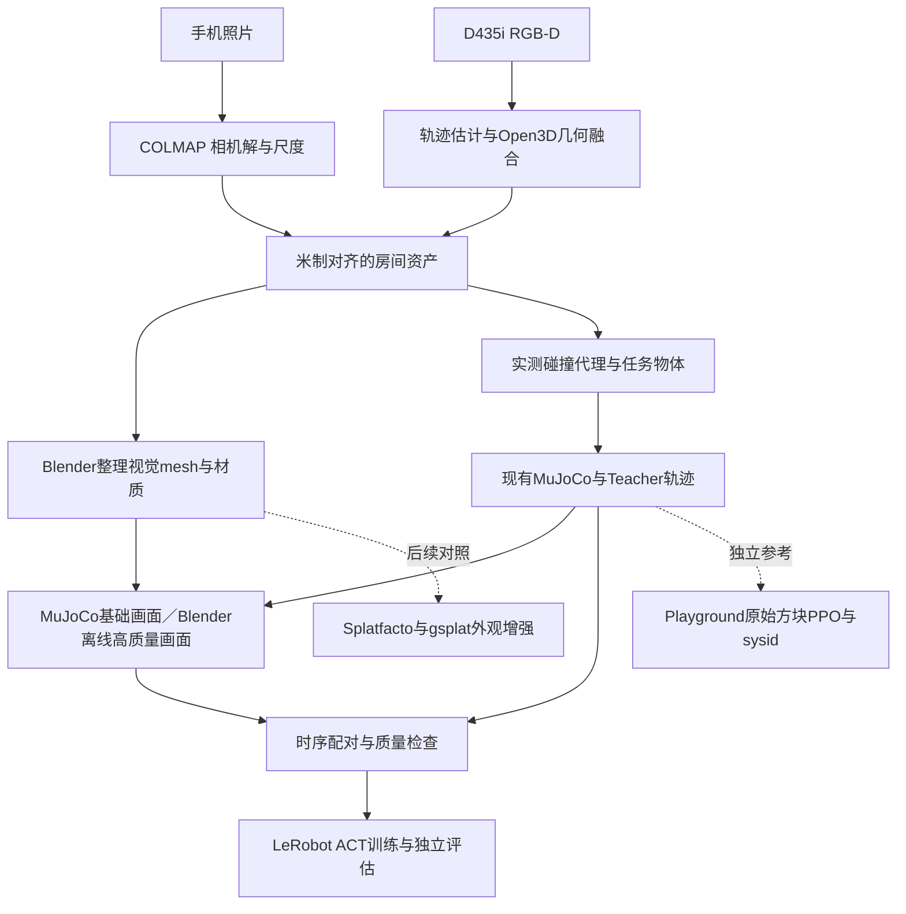

# SO-101房间重建与仿真训练开源替代方案比较

> [!important] 当前范围已收敛（2026-11-10）
> 用户明确本任务先做**可交互场景Sim重建**，SO-101训练→真机部署暂缓。当前比较与执行优先级见 [[interactive-room-sim-reconstruction-alternatives-2026-11-10|场景优先报告]]。本文训练／部署章节保留作后续资料，不属于当前验收；采集、米制尺度与分层物理建模继续适用。

> [!summary] 决策
> **有可组合的开源路线，也有SO-101训练到部署的公开实现；本轮未找到一个同时完成手机／D435i整房扫描、高保真可动物体、精确接触、双相机ACT、真机部署且所有必要环节均开放的单一项目。** 推荐保留当前MuJoCo工程：COLMAP＋Open3D＋Blender建立房间和任务资产，现有Teacher／Recorder接LeRobot ACT；以MuJoCo Playground的SO-101视觉PPO与系统辨识作为独立参照。高保真先用带贴图mesh和离线渲染；GS作为第二阶段可选增强，使用Splatfacto／gsplat，不把Isaac作为开源主线的必需项。

> [!important] 完成边界
> 截至2026-11-10，本轮完成官网／固定提交README、许可、目录树和部分源码核阅与归档；没有安装、编译、下载大型权重／场景、跑训练或动真机。兼容性和性能结论属于候选判断，非已复现。现有项目HEAD读回为`49119c1531c20a0928b5af0713738a729e629ae6`；接口依据今日先前的本地快照，未重新逐文件审计全部工作树。

## 1. 分类、检索与“完整开源”的定义

主分类R05（产品、平台与工具选型），次分类R06（候选池比较）、R04（技术实现）。研究问题是如何以可本地运行、可修改和可追溯的组件，替代Niantic商业重建与Flexion未公开的训练／部署链，同时保留用户已有SO-101工程和手机＋D435i采集方案。

检索范围：截至2026-11-10的项目官网、官方GitHub和文档；纳入有明确代码入口、重建／渲染／SO-101训练能力之一的项目。重点比较六条路线和底层组件，不做所有机器人项目的穷举。排除只有视频、只重建无物理／训练接口、没有SO-101证据却被当即插即用的方案；社区项目可作参考但许可不足则不进入开源主线。对精确性能不使用不同任务成功率排序。

“完整”须拆成四项：

1. **代码与授权完整**：有源码和明确许可，模型、资产、子模块分别核对；可下载不等于授权完整。
2. **任务链完整**：能否从任务定义、数据／训练走到模拟和真实运行；不等于提供房间扫描。
3. **项目适配完整**：是否支持我们的机械版本、相机、8D状态、6D绝对动作和Teacher边界；机器人同名不代表接口相同。
4. **结果可复现**：训练数据、资产、权重、超参数和评价集是否公开；私有测试集不能完整复现榜单。

本报告“开源主线”指核心应用代码／算法和资产处理可由明确开源许可组件完成，不承诺GPU驱动、CUDA、操作系统、基础模型训练数据和所有可选依赖均开放。CPU可降低专有GPU依赖，但不承诺训练／渲染吞吐可接受。我们仍需自己编写适配代码与场景，不能把“可组合”叫“一键现成”。

## 2. 六条路线对照

| 路线 | 房间与高保真外观 | SO-101训练／部署 | 开放边界 | 接现有工程的代价 | 结论 |
|---|---|---|---|---|---|
| A 本地mesh＋MuJoCo＋LeRobot ACT | COLMAP求位姿；Open3D融合已定位RGB-D；Blender清理／UV贴图／材质与可选离线渲染 | 复用现有Teacher生成轨迹，自己补导出／适配并用ACT学习 | 主要组件许可明确；资产自采自建，仍需依赖审计 | 最少改物理与控制；照片贴图与数据桥需做 | **主路线，先跑通** |
| B A的重建层＋MuJoCo Playground | 复用A资产，原项目不负责自动整房重建 | 已公开SO101视觉PPO训练、模拟／真实部署、遥操作与sysid | Apache-2.0主代码；硬件／模型资产依其条款 | 同为MuJoCo但任务层／动作合同不同，不可直接替换现有控制 | **独立最小训练参照**，优先看sysid |
| C Splatfacto／gsplat＋MuJoCo＋ACT | GS静态外观和普通物理资产分离；需要自建融合渲染 | 复用A的轨迹与训练；没有现成通用SO-101 GS桥 | Nerfstudio／gsplat主代码Apache-2.0 | 高：遮罩、相机、深度合成、可动对象和数据时序 | **第二阶段外观增强**，离线先行 |
| D SplatSim | 有手机采集、COLMAP／GS训练、关节分割配准与轨迹回放渲染说明 | 示例为UR5／PyBullet，不是SO-101开箱可用 | 根目录未见总许可；实际固定Gaussian依赖为研究／非商业条款 | 机器人资产、渲染／物理桥及训练数据都须迁移 | **借鉴实现，不作为完整开源基线** |
| E ManiSkill＋SO101社区sim2real教程 | 桌面场景、背景采集／匹配；不等于三维整房 | Luoyadan分支有SO101GraspCube视觉PPO与真实评估流程 | ManiSkill核心Apache-2.0；教程根目录未发现覆盖新增代码的LICENSE | 改用SAPIEN／PhysX，动作、模型和数据重新对齐 | **参考对照，许可先澄清** |
| F Isaac Lab：Workshop／SO-101 Bench | 高质量USD任务资产，但不提供手机自动整房扫描 | Workshop示范任务流程；Bench有任务、微调配方、评估、真实运行与模型入口 | 项目代码Apache-2.0／部分BSD；Isaac附加组件、基础模型和资产另有条款；Bench有私有测试内容 | 新仿真栈＋版本隔离，需RTX且不能直接替代ACT合同 | **较完整的SO-101示例路线**，不是严格全栈开源首选 |

“代价最少／高”是针对本地已有MuJoCo与Teacher的工程判断，不是独立工时测量。来源A：[727]、[728]、[729]、[738]、[739]；B：[723]、[733]–[735]；C：[724]、[725]；D：[731]、[736]、[740]、[741]；E：[721]、[726]、[732]；F：[720]、[722]、[737]。

## 3. 最值得复用的新候选：MuJoCo Playground

固定提交`66640404324ddfefd0223359a7b15974c22d6d63`下，不只有概念页面：目录存在`SO101PickCubeVision`相关task实现、`deploy/run.py`、模拟／真实适配、系统辨识实现与测试文件。官方文档给出训练→仿真部署→真机部署流程。[723][733][741]

它的sysid从遥操作MCAP日志拟合6关节的armature、frictionloss、stiffness、damping共24参数，并估计串行命令时延，生成报告。这比先追求更漂亮的房间背景更可能补上我们的执行器误差；仍须用独立负载／轨迹验证，不能认为sysid覆盖杯子摩擦或所有接触。[734]

**和我们接口的实质差异**：固定task源码里视觉任务控制10Hz，使用限幅／平滑的**增量关节动作**；腕相机渲染64×64，策略图像下采样16×16。现有ACT设计是head／wrist双640×480、8D状态、6D绝对reference并对齐`t_k+0.1s`。相同10Hz不是接口兼容证明。[741] 不能将Playground动作向量直接发给现有执行器，或把它的观测误当我们双相机ACT的实现。

官方部署说明报告在3套机器人装置测试，同时明确较暗阴影仍可能造成视觉域差距、标定偏差会导致触桌。它只是**方块抓取的作者案例**，不是我们杯子／整房重建／10Hz双RGB的已验证成绩。[733] 硬件模块使用Feetech／LeRobot相关驱动，需实际校准；本轮不执行任何真实模式命令。[735]

建议在独立环境复现其**原始方块任务**，冻结提交与依赖后先sim-only；将sysid方法／测量结果迁回现有工程。若用户后续决定用RL替代或补充ACT，再迁移任务；当前不要迁移整个Teacher执行链。

## 4. 更完整的SO-101示例为什么仍不是首选

### 4.1 NVIDIA SO-101 Workshop

公开仓库包含机器人／任务资产和训练、采集、部署学习流程，主任务是vial-to-rack，可作具体端到端学习入口。README测试GPU列RTX6000 Pro、5090和RTX6000 Ada，不能据此推断其它卡不能跑，也不能给未核验机器许诺吞吐。[722]

项目代码Apache-2.0不覆盖整个运行系统。Isaac Sim自身LICENSE明确：仓库软件为Apache-2.0，构建和使用还需按其它条款许可的Omniverse Kit SDK、模型和纹理等。[737] 因而可以称“公开源码项目＋有额外许可的运行环境”，不应笼统称完全闭源，也不应说整条依赖链均为Apache。

### 4.2 SO-101 Bench

仓库发布Isaac Lab扩展、物体目录、验证任务、评估与策略server、微调配方、遥操作／数据工具、真实运行入口，以及数据／checkpoint链接。主代码Apache-2.0，模型继承各基础模型许可；数据资产不能从代码许可推导。[720][741]

README要求Isaac Sim5.1与其测试的Isaac Lab环境；LeRobot侧Python≥3.12、模拟侧Python3.11，通过独立进程通信。文档写出的Lab版本记为“0.54”，实施前还需核对实际包／扩展对应关系，不能混入前轮NuRec6.2工具链。[720]

其主榜916测试episode含未释放对象／背景，公开验证集135条，不能声称所有测试资产公开。公开配方和模拟示教很有参考价值，但不是整房扫描器；其训练样本、相机overhead／wrist与我们的head／wrist合同也需转换。作者公开摘要承认仿真可能高估真实成功；“排名一致”不等于两边成功率相同。[720] 若目标改成大规模VLA比较，它会比我们从零造评测更值得优先试；当前目标是现有房间＋ACT，收益不足以支持立即更换物理栈。

## 5. Gaussian路线的真实工程缺口

SplatSim公开说明了采集、COLMAP、静态GS、URDF转点云、人工／ICP对齐、关节驱动分块以及记录轨迹后回放渲染；因此是很好的研究参考。[731] 但它依赖PyBullet／UR5示例，根许可未见明确覆盖，其实际gitlink固定的`jwang078/gaussian-splatting`许可含非商业／研究限定。[740][741] 不能只看“Code”按钮便称全链可商用开源。

我们的C路线使用Apache-2.0的Splatfacto／gsplat构建同类能力，避免直接依赖原始受限Gaussian实现；它是**拟开发路线**，不是已经存在的完整集成项目。需要补的不是一个导入函数：

- 从GS背景排除机器人、杯子和其他动态对象，否则出现静态重影。
- 每个真实相机有独立内参／畸变／光轴、外参及时间语义，所有资产共用实测米制坐标。
- 机器人和杯子先用mesh，按MuJoCo状态渲染；用可核验的深度／遮挡合成，不能简单把机械臂图像贴到GS前景。
- GS的渲染深度／期望深度不等同于碰撞几何或实测深度真值；在桌边与半透明区域尤其需检查。
- 分开处理动态阴影、反射和曝光；GS通常携带采集时光照，不支持随意重打光。必要时把整个任务区改为mesh＋材质。
- 先离线逐帧对齐，再考虑在线运行。训练图像到动作标签的配对不是渲染器自动保证。

3DGRUT本身也有Apache-2.0源码，可作训练／导出替代；若最终使用Isaac NuRec则重新引入其它许可与RTX环境。因此本轮对**尽量开放、保留现有工程**的目标，选择gsplat作为可选渲染层，而非将Isaac设为唯一视觉出口。[730][737] PLY／USD能转换不等于渲染参数、碰撞与动作都兼容。

## 6. 推荐的具体主路线

### 6.1 重建：手机与D435i各做擅长的部分

1. 按[[so101-workbench-pilot-capture-sop-2026-11-10|小样SOP]]完成原始手机图、RGB-D录制、独立保留图、尺寸与基准。保留场景版本、设备配置与文件hash。
2. 手机照片→COLMAP求相机位姿与稀疏结构；加入实测尺度，统一`room`坐标。D435i需要另外估计其移动轨迹／回环或多视图配准，不能套用手机位姿；相机内参、RGB／depth外参和深度尺度全部保留。
3. Open3D先作小样RGB-D里程计／多视图配准和pose graph优化候选，再TSDF融合；若轨迹不稳先改采集或用实测平面构建结构。**TSDF只融合给定姿态下的深度，不替你解决定位。**可后续评估RTAB-Map，但不是首个小样的硬依赖。Open3D原理说明沿用SRC-robotics-711。
4. Blender清理可视mesh、UV和照片贴图、补有实测依据的墙桌平面；隐藏面标未知，动态任务物体分离。UV／贴图整理有人工步骤，本轮没有找到全自动能稳定达到任务精度的保证。
5. 建两套资产：较精细的视觉mesh／贴图；分块盒体／凸体组合的碰撞代理。全房mesh不能作为单一凹形碰撞体直接交给MuJoCo。杯子、夹爪垫和安装基准按实测建模，碰撞语义沿用SRC-robotics-708。

### 6.2 数据与训练：ACT主线不变，RL独立对照

这里MuJoCo为物理状态权威；Blender是拟实现的离线相机出口，按记录的关节／物体／相机状态设置场景并渲染，不能同时独立推进另一套物理。MuJoCo原生渲染适合低成本基线；高保真离线渲染会增加材质、相机、灯光与数据映射工作，不承诺速度。

沿用现有Teacher与Recorder解耦：渲染、数据QC失败拒收episode，不能反向控制Teacher的安全和成功判定。导出必须保持head／wrist双RGB、状态顺序／单位、6D绝对reference和`t_k+0.1s`标签。模型只吃部署可得观测；杯子真值／接触／depth可用于教师与质检，不暗中加入ACT输入。LeRobot的默认SO101状态与相机字段不等于我们8D状态，须定制字段与归一化／动作适配。[729] 本地设计依据SRC-robotics-688／704。

如果只想最快体验“开源SO-101视觉RL→真机”的案例：选**Playground原任务**做旁路PoC，比先造GS集成器更直接；如果目标是现有ACT系统用上房间模型，则仍选A，不能因旁路能抓方块就替代整个系统。

### 6.3 环境与版本管理

- 在独立目录／虚拟环境锁定候选，不在现有机器人环境里直接升级。本文记录的提交是证据版本，不是已经通过的兼容锁文件。
- Mac用于采集管理、基础MuJoCo与资产检查；大批量视觉训练、Splatfacto／gsplat主要按Linux NVIDIA GPU方案验证。用户当前GPU／显存、Viewer、相机与远程桌面就绪状态仍未知。
- 先运行单环境与短轨迹，再测并行数；双640×480与16×16策略图像的显存／渲染成本不可按比例随意套算。训练与离线渲染可分时执行。
- 固定：代码SHA、Python、MuJoCo／Warp、PyTorch、CUDA、COLMAP、Open3D、Blender、LeRobot、相机标定及资产hash。不要将多个仓库最新main当成已验证组合。
- 环境成本中等，硬件采购和云算力未询价；本轮不估造商业报价。若严格避免专有GPU软件，先用CPU完成小样和离线验证，再根据实测决定是否接受CUDA链。

## 7. 分阶段执行、验收与停止条件

| 阶段 | 具体产物 | 通过条件 | 停止／返工信号 |
|---|---|---|---|
| S0 采集 | 小样原图、RGB-D、测量表、保留集、回放报告 | 小样SOP A关通过，双方都可见共同基准 | 只有RGB没Depth／没独立尺度／数据打不开 |
| S1 可运行资产 | 房间局部视觉mesh、MJCF碰撞、坐标JSON、10条独立距离检查 | 小样尺度≤max(10mm,1%)初始目标，关键底座／桌面精建目标≤3mm | 凸包封死自由空间，桌面与机器人穿透 |
| S2 开源训练旁路 | 固定Playground版本、原始方块sim-only短训练／回放、资源报告 | 明确非平凡地学到任务、观测动作检查、可重复记录 | 安装冲突／观测泄漏／未训练只回放示例；禁止以训练日志替代真机验收 |
| S3 现有ACT主线 | 同轨迹MuJoCo基础渲染＋可选Blender离线画面，LeRobot数据适配 | 图像／状态／动作时间一致，保留视角／几何通过，教师不依赖录制 | 换图像导致标签错配，双相机不同步 |
| S4 表示对照 | 简单场景、重建mesh、可选GS三组 | 同任务／预算／split和种子，分别报告视觉与任务差异 | GS制作复杂但无留出集增益则不继续扩展 |
| S5 真机留出 | 冻结模型、受控真实试验、成功／失败／干预日志 | 达到事先约定任务门槛，并报告不确定性 | 触桌／标定异常先修；不得边调边称零样本 |

建议先做S0–S1，再用独立环境验证S2，随后接S3；不要同时引入新房间、新物理引擎、新策略与新渲染器。数量／精度是工程验收提案，不是已测结果。工期在S0、S2后按真实处理时间／显存修订；前轮5–11工作日是原方案条件预算，**不包含新GS融合渲染器和全部旁路系统的开发承诺**。

## 8. 事实、判断、假设与反方证据

**事实**：固定仓库存在上述训练／部署／sysid／数据入口；许可证与部分接口已静态核对。**判断**：保留已有MuJoCo比立即换PhysX更少接口变化；Playground是值得先验证的参考。**假设**：重建房间外观能改善我们的ACT；用户机器足以完成小样；均未验证。

反方证据：Playground作者仍提示暗阴影域差和标定误差；Bench测试有私有内容且资产／模型条款分离；SplatSim有明确非商业依赖；ManiSkill核心官方示例中SO100支持不能自动外推SO101，但社区分支确有SO101实现。GS细节丰富仍可能无法准确表示杯口／动态阴影。

改变推荐的条件：如果已有资产能在Isaac快速满足相机与任务合同，且用户接受其运行许可和换栈成本，可把F升为主线；如果mesh已达到真实任务目标且GS无可重复增益，不再做C；若Playground原任务都无法在目标设备稳定运行，不贸然将其移入生产工程。

## 9. 商业应用可能性

使用者是机器人研发／实验室，决策和付款者通常为负责人；高频问题是重复搭场景、校相机、辨识执行器和排查仿真差距。首批价值场景是SO-101视觉回归、低成本训练数据生成、真实日志到物理参数的校准。本案成熟度仍是方案，作者任务演示不是我们的付费试点。相比托管服务，增量在可审计、可本地处理和少供应商锁定，代价是采集／材质／适配／维护人工与GPU；需量化总工时、返工率、每合格episode成本和真实任务提升后才能算ROI。

近期1–2年判断：垂直集成服务可以小样验证，置信度中；3–5年规模复制需要跨房间／机械版本的维护成本和复购数据，待验证。中国团队可复用全球开源工具形成自有测量／校准与数据流程，但核心GPU／软件依赖和基础模型许可仍要逐项判断；本报告不新增未经核验的政策补贴或市场规模。

## 10. 中小型创业者的机会

**可立即验证**：房间＋工作台资产、相机／执行器校准、可复现训练基线与验收报告的一体交付；MVP就是本小样，首批客户是有低成本臂却缺仿真工程能力的团队。首个可收费物应是通过独立距离和配对图检查的资产／数据包，不是扫描视频。团队需重建、机器人控制、数据工程能力，启动资金以已有设备＋单工作站的小额至中等投入为假设，先以小样周期验证，无报价／订单证据。

**需要条件成熟**：资产更新、MCAP到数据集适配与自动QC、系统辨识维护服务。大平台可能提供相同功能，差异应来自现场交付、客户工作流和可复核误差报告；客户数据仅在授权内积累，复购依赖实测维护收益。**不建议进入**：以许可不明或研究限定代码打包商用，宣称“全自动整屋毫米级”“仿真训练保证真机成功”，或从零开发通用渲染／物理引擎。下一步是在本案验收后找一个外部机器人团队做独立试用与付费意愿验证。

## 11. 知识冲突与此前方案的修订

此前[[so101-room-high-fidelity-sim-reconstruction-plan-2026-11-10|整房方案]]优先“3DGRUT＋Isaac视觉／MuJoCo物理”，目标是照片级视觉并尽量沿用官方USD路径；本轮用户新增**完整开源优先**，主线改为mesh＋MuJoCo／Blender离线，GS使用gsplat自行集成，Isaac降为可选对照。这是目标约束下的选型调整，不是之前方案不可行。

仍保留此前的手机＋D435i采集、米制尺度、相机标定、动态物体分离和接触区精建要求。不能把“选了开源工具”写成“已完成替代、已证明真机迁移”。

## 关联连接

- [[so101-workbench-pilot-capture-sop-2026-11-10|现场采集SOP与空白模板]]
- [[so101-room-high-fidelity-sim-reconstruction-plan-2026-11-10|原整房高保真方案]]
- [[niantic-flexion-real2sim-zero-shot-project-fit-2026-11-10|Niantic／Flexion开放与实验边界]]
- [[_sources/so101-open-source-alternatives-source-set-2026-11-10|本轮来源、版本与授权核查]]
- [[robot-physics-engines-sim2real-2026-10-26|物理引擎与迁移误差]]

## 来源

本轮SRC-robotics-720–741均一级代码／官方资料，证据强度用于说明公开内容，不用于保证运行。各固定版本、原文归档、许可证与API tree见来源集；重要论断可沿以下引用回溯。

[720]: ../../../raw/robotics-embodied-ai/documents/SRC-robotics-720-5hadytru-so101-bench-fixed-readme.md "SRC-robotics-720 5hadytru/so101_bench fixed README"

[721]: ../../../raw/robotics-embodied-ai/documents/SRC-robotics-721-luoyadan-lerobot-so101-sim2real-fixed-readme.md "SRC-robotics-721 Luoyadan/lerobot_so101-sim2real fixed README"

[722]: ../../../raw/robotics-embodied-ai/documents/SRC-robotics-722-isaac-sim-sim-to-real-so-101-workshop-fixed-readme.md "SRC-robotics-722 isaac-sim/Sim-to-Real-SO-101-Workshop fixed README"

[723]: ../../../raw/robotics-embodied-ai/documents/SRC-robotics-723-google-deepmind-mujoco-playground-fixed-readme.md "SRC-robotics-723 google-deepmind/mujoco_playground fixed README"

[724]: ../../../raw/robotics-embodied-ai/documents/SRC-robotics-724-nerfstudio-project-gsplat-fixed-readme.md "SRC-robotics-724 nerfstudio-project/gsplat fixed README"

[725]: ../../../raw/robotics-embodied-ai/documents/SRC-robotics-725-nerfstudio-project-nerfstudio-fixed-readme.md "SRC-robotics-725 nerfstudio-project/nerfstudio fixed README"

[726]: ../../../raw/robotics-embodied-ai/documents/SRC-robotics-726-haosulab-maniskill-fixed-readme.md "SRC-robotics-726 haosulab/ManiSkill fixed README"

[727]: ../../../raw/robotics-embodied-ai/documents/SRC-robotics-727-colmap-colmap-fixed-readme.md "SRC-robotics-727 colmap/colmap fixed README"

[728]: ../../../raw/robotics-embodied-ai/documents/SRC-robotics-728-isl-org-open3d-fixed-readme.md "SRC-robotics-728 isl-org/Open3D fixed README"

[729]: ../../../raw/robotics-embodied-ai/documents/SRC-robotics-729-huggingface-lerobot-fixed-readme.md "SRC-robotics-729 huggingface/lerobot fixed README"

[730]: ../../../raw/robotics-embodied-ai/documents/SRC-robotics-730-nv-tlabs-3dgrut-fixed-readme.md "SRC-robotics-730 nv-tlabs/3dgrut fixed README"

[731]: ../../../raw/robotics-embodied-ai/documents/SRC-robotics-731-qureshinomaan-splatsim-fixed-readme.md "SRC-robotics-731 qureshinomaan/SplatSim fixed README"

[732]: ../../../raw/robotics-embodied-ai/documents/SRC-robotics-732-stonet2000-lerobot-sim2real-fixed-readme.md "SRC-robotics-732 StoneT2000/lerobot-sim2real fixed README"

[733]: ../../../raw/robotics-embodied-ai/documents/SRC-robotics-733-mujoco-playground-so101-visual-deployment.md "SRC-robotics-733 MuJoCo Playground SO101 visual deployment"

[734]: ../../../raw/robotics-embodied-ai/documents/SRC-robotics-734-mujoco-playground-so101-system-identification.md "SRC-robotics-734 MuJoCo Playground SO101 system identification"

[735]: ../../../raw/robotics-embodied-ai/documents/SRC-robotics-735-mujoco-playground-so101-real-hardware-setup.md "SRC-robotics-735 MuJoCo Playground SO101 real hardware setup"

[736]: ../../../raw/robotics-embodied-ai/documents/SRC-robotics-736-original-gaussian-splatting-license.md "SRC-robotics-736 Original Gaussian Splatting license"

[737]: ../../../raw/robotics-embodied-ai/documents/SRC-robotics-737-isaac-sim-repository-license.md "SRC-robotics-737 Isaac Sim repository license"

[738]: ../../../raw/robotics-embodied-ai/documents/SRC-robotics-738-blender-gpl-copying-terms.md "SRC-robotics-738 Blender GPL copying terms"

[739]: ../../../raw/robotics-embodied-ai/documents/SRC-robotics-739-mujoco-software-license.md "SRC-robotics-739 MuJoCo software license"

[740]: ../../../raw/robotics-embodied-ai/documents/SRC-robotics-740-splatsim-fixed-submodule-dependencies.md "SRC-robotics-740 SplatSim fixed submodule dependencies"

[741]: ../../../raw/robotics-embodied-ai/documents/SRC-robotics-741-open-route-license-code-review.md "SRC-robotics-741 SO101 open route fixed license and code evidence"

补充产物：[六路线比较CSV](../../../raw/robotics-embodied-ai/data/so101-open-source-route-comparison-2026-11-10.csv)、[固定仓库与hash](../../../raw/robotics-embodied-ai/data/open-so101-reconstruction-route-provenance-2026-11-10.json)。
