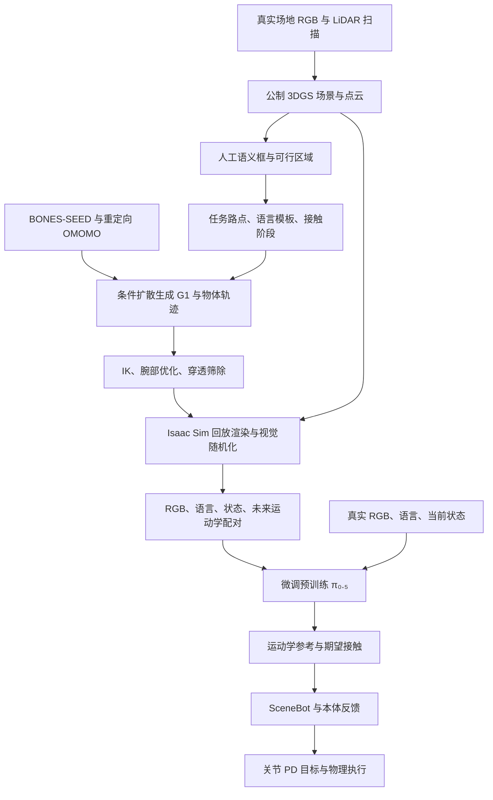

# VLK 论文与实现深研

## 结论摘要

1. **适合借鉴其数据工程方法，当前不适合把 VLK 当现成策略接入我们的机器人。置信度高。**VLK 将场景特权信息、可控运动合成和第一人称渲染连接成监督数据；G1 的身体、动作空间、接触控制器和大箱体任务均与 SO-101、Microduck 不同。
2. **“零样本”指目标任务没有真机微调，不是没有真实数据、没有人工、也不是未知建筑通用。置信度高。**它用了真实场地扫描、人工标注、既有运动数据和 π₀.₅ 预训练；Lab 与 Apartment 分别训练场景策略，在同两处物理环境改变家具布局后部署。
3. **论文真机支持导航和有限箱体搬运，精细抓杯没有证据。置信度高。**表面取放明显弱于地面操作；作者明确承认小物体和精确抓握不在能力覆盖内。
4. **实现可获得性分层：VLK 主训练/生成代码与权重未由作者项目入口提供；SceneBot 有作者公开的推理演示代码和模型资产，但不等于完整训练复现。置信度高。**已检查固定提交源码、模型元数据与文件树，未运行推理或演示。
5. **优先顺序：SO-101 先验证专家轨迹→因果配对→物理回放→留出评估；Microduck 先研究视觉高层→速度命令→既有步态。置信度中。**3DGS 应在基线和相机/动力学误差明确后作为视觉层增量比较，而非项目启动的前置条件。

> [!warning] 证据状态
> 本文是论文全篇、附录、PDF 表格及公开代码的静态核阅与本地项目适配研究。没有训练、机器人动作、GPU benchmark、完整 VLK 复现或真机迁移验证。报告完成不表示 PoC 通过。

## 分类、范围与来源

- **主分类 R04**：解释论文机制、数据流程与实验有效性；**次分类 R05**：判断对现有项目的兼容性、成本和最小验证条件。
- 分类依据：上一轮微信来源已提取出“48k 合成轨迹、零真机微调、场景重建”的主张，本轮以论文和作者实现核对这些主张，不沿用文章的技术扩写作为事实。
- 核心论文：Wang 等，*VLK: Learning Humanoid Loco-Manipulation from Synthetic Interactions in Reconstructed Scenes*，arXiv:2606.30645v1，2026-06-29，19 页。正文、附录全部阅读；PDF 第 7、16、19 页图表作视觉交叉检查。
- 截止：2026-11-10。项目页、论文和源码为 S 级一级技术资料；作者数字依然是自报告。未使用第三方实现宣称来补齐官方缺失模块。
- “我们的项目”在本轮指已存在的 SO-101 `robot_demo_001/moveit-demo` 与 `microduck/microduck_rl`；只读检查本机文件，不推断 ai-station 上的安装产物或运行状态。
- 详细证据入口见 [[_sources/vlk-paper-code-project-fit-source-set-2026-11-10|来源集]]；下文 P 指 [论文 PDF](../../../raw/robotics-embodied-ai/documents/SRC-robotics-681-vlk-paper-v1.pdf)，H 指 [HTML 全文](../../../raw/robotics-embodied-ai/documents/SRC-robotics-680-vlk-paper-v1-full-text.md)。重要数字均附章节、表格或页码。

## 一、VLK 究竟学什么

### 1.1 从直接电机动作改为运动学接口

系统输入第一人称 RGB、当前语言子指令和机器人状态，输出未来 **1 秒、30 帧**全身运动学轨迹，再由 SceneBot 跟踪器产生关节 PD 目标。上层决定“身体如何运动、何时维持腕部接触”，下层处理当前动力学条件下怎样跟上参考；它不是将 RGB 直接映射成所有电机扭矩的单网络。跟踪器不看 RGB 和语言。P §3.2–3.3，pp5–6。

上层每帧目标包括根部平移增量、偏航变化、根高、朝向表示、关节角的 sin/cos，以及左右腕接触标签。用 sin/cos 避免角度在正负π边界跳变；用 heading-normalized 表达减弱全局朝向差异。它仍然绑定 G1 的骨架、关节顺序、尺度和接触语义，并不会因采用运动学表示就天然跨本体。

**接触标签是意图接口，不等于实测接触。**论文 §3.2 脚注明确：部署时当前状态中的接触项采用自回归预测，而非直接观测。腕部期望接触、脚底接触辅助监督、物理引擎真实接触和安全监督必须分开。该脚注在 Defuddle 主正文中不完整，已补存 [HTML 原文件](../../../raw/robotics-embodied-ai/documents/SRC-robotics-680-vlk-paper-v1-full-text.html) 并以 PDF 校对。

### 1.2 数据和执行的两条路径

图为依据 P §3、附录 A/B 的分析重绘；不是作者已发布的可执行模块清单。

## 二、合成数据生成流程：每步输入、输出和人工成本

### 2.1 场景采集与标注

**事实**：用 iPhone 14 Pro 的 Polycam 扫描，结合 RGB 与 LiDAR 深度恢复公制场景；不是本文前驱微信文章讨论的 Niantic 360° 步行采集流程。优化 3DGS 后提取点云，用 `viser` 交互工具人工放置、旋转和缩放语义 3D 有向框，并在地板标点形成可行走多边形。框和多边形供任务采样，3DGS 供视觉渲染。P §3.1、A.1，pp4、13。

**工程含义**：场景真值和任务可行域是离线教师资源；不是部署时可免费得到的观察。要记录扫描覆盖、尺度、坐标、物体身份和标注版本。看起来像照片的场景不自动包含杯子摩擦、质量、可抓部位或可靠 collider。

### 2.2 路点、目标与语言

- 导航从已标注目标物、可行区域采样起点和路点；起点还要求目标位于相机视野内且不被主要结构遮挡，否则重采样。因此训练并非任意目标、任意初态的开放世界搜索。
- 原地转身将各路点固定在初始位置，变化转向条件。
- 搬箱任务按支撑面高度设计接近、双腕接触、提升、搬运和释放阶段；相对腕姿态在物体坐标系定义。
- 语言由任务元信息和语义标签套模板生成；省去逐条语言标注，并不证明开放式长指令理解或规划能力。P A.2，pp13–14。

**质量门**：需要保存采样拒绝原因、可达/碰撞条件和目标可见性。若只报告保留轨迹数量，无法判断复杂场景中的有效产出率。

### 2.3 运动生成：两套先验和一个 G1 改造

| 分支 | 来源与机制 | 生成条件 | 输出 |
|---|---|---|---|
| 目标导航 | BONES-SEED 中的 G1 运动先验 | 指令、初始 G1 状态、稀疏场景路点 | 全身行走/转身轨迹 |
| 箱体交互 | OMOMO 人体—物体交互，经 OmniRetarget 映射到 G1；沿用 CHOIS 条件 DDPM/Transformer 思路并适配 G1 | 前述条件，再加物体初态、BPS 几何编码、相对腕位姿和接触标签 | 耦合 G1—物体运动轨迹 |

生成器的关节位置/6D 旋转/sin-cos 状态与下游 VLK 的压缩逐帧状态不是完全相同的格式。作者还增加可微 G1 FK 损失，以约束末端几何。**不能用公开 CHOIS 人体权重直接导出 SO-101 或 Microduck 控制序列。**P §3.1、A.3。

### 2.4 后处理与有效性

脚接触阶段通过 IK 固定支撑脚；腕部参考借鉴 EgoAllo 式优化，将腕姿态拉向物体局部目标；随后筛除场景穿透。P A.4、§4.2。

**关键边界**：这是运动学质量修复和几何过滤，不能替代真实物理闭环。不会穿墙仍可能滑脚、过力、失稳或夹不住箱体。生成效率的 1,000 条口径是否计入所有拒绝/重生成、筛除阈值与最终跟踪成功率，公开材料未说明到足够复现的程度。

### 2.5 回放渲染与配对

在 Isaac Sim 中加载 3DGS 和 G1，回放合成的机器人/物体轨迹，按真实头部 ZED 2i 的安装外参渲染第一人称 RGB；再形成 `(图像, 指令, 当前状态, 未来运动学)`。后渲染使昂贵视觉与运动生成解耦，但重放时必须让物体、机器人和相机处于同一时刻、同一坐标链。P §3.1、A.5。

作者明确随机化相机、照明和成像。PDF Table 3（p16）核对后的范围如下；这些是作者实验参数，不是我们的默认校准范围。

| 项目 | 论文范围 |
|---|---|
| 相机平移 / 旋转 / 焦距 | ±2 cm / ±3° / ±2% |
| Dome 光强 / yaw | 400–1500（作者渲染器参数，非实测 lux）/ −π至π |
| 亮度 / 对比度 / 饱和度 | 0.8–1.2 / 0.8–1.3 / 0.7–1.4 |
| 色相 / 高斯噪声标准差 / 模糊σ | −0.05至0.05 / 0–0.05 / 0–1.0 |

**不要把离线重新配图理解为可以随意替换真实观测。**若后处理改了轨迹、相机或杯子状态，要重做时间和几何一致性；不能把碰撞不成立的“好看动作”算作已成功示教。

### 2.6 数量与成本复算

P §4.2：每个 environment 有 4 个扫描布局、12 个生成模式，每模式每布局 1,000 条，即 **48,000 条/环境**。六个正式评测模式之外，还有随机行走、转身、持物行走等辅助模式。Lab 与 Apartment 两环境按该口径可推得 96,000 条；这是口径推导，不是独立下载验数。

每 1,000 条在单 L40S 上：运动生成约 4 GPU·h，渲染约 8.3 GPU·h。因此每环境约 `4×12×(4+8.3)=590.4 GPU·h`，两环境约 `1,180.8 GPU·h`。引言“48k/600 GPU·h”与单环境复算接近，但不要写成全部两场景、含训练的端到端总成本。

若 L40S 单价为 `P 元/GPU·h`，单环境这两道工序的算力成本估计为 `590.4P`；完整成本还包括扫描、标注、先验训练/重定向、π₀.₅ 微调、跟踪器训练、失败重生成、存储和真机评测。作者未提供可复核的全成本账单、有效样本率、平均轨迹时长与完整训练超参数。渲染在该两工序中约占 67.5%，压低失败与重复渲染比只提高运动生成速度更值得先测。计算见[参数与一致性 JSON](../../../raw/robotics-embodied-ai/data/vlk-derived-cost-and-consistency-2026-11-10.json)。

## 三、策略训练和实时实现

### 3.1 训练目标

初始化自 π₀.₅，全模型微调为 G1 运动学输出。论文用 flow-matching 框架的 clean-trajectory/x₀ 预测：在噪声与真实未来轨迹间插值，让模型根据 RGB、指令和当前状态恢复干净轨迹。主目标是未来轨迹平方误差，附加脚接触 focal loss、累积根位移、踝/腕 FK 和支撑期滑脚损失。P §3.2、B.1，pp5、16–17。

PDF 最终权重为 `1.0 trajectory + 0.5 foot-contact + 0.2 accumulated-root + 1.0 ankle-FK + 1.0 wrist-FK + 0.05 foot-skating`。这里的 **0.05** 不能误抄为 0.5，也不能照搬到单臂任务。论文没有充分披露优化器、学习率、batch、步数、checkpoint、随机种子、标准化完整 schema 等工程信息，无法仅靠公式精确复现训练。

### 3.2 控制周期与延迟应分开

| 层 | 论文披露 | 不能据此推断 |
|---|---|---|
| VLK 输出网格 | 30 Hz、30 帧、覆盖1秒 | 模型每秒推理30次 |
| VLK 重规划 | 约1.8 Hz，异步接收新 chunk | 31ms直接成为全系统反应时间 |
| 跟踪器 | 50 Hz；RTX 5000 Ada 平均每tick约4.3ms | 小型边缘板或我们的执行器也能达到同指标 |
| 大模型推理 | 外部 RTX 5090、Triton，模型约31ms | 本地 Mac 或 Microduck 板载可运行 |
| 含打包/网络/变换/合并的重规划 | 作者平均约63ms | p99、断网行为、全链路最坏延迟已验证 |

真实输入取 ZED 2i 左侧 RGB 的672×376图像，再缩放为224×224；相机安装在定制头部支架，不能默认等同我们的固定head/wrist视角。相邻 chunk 重叠10帧后合并。部署还从最近0.3秒图像窗口中选 Laplacian 方差最大的清晰帧；因此需要审计图像年龄与机器人状态配对，清晰不等于最新。P §3.4、B.3–B.4，pp6、18–19。

**论文仿真评测在模型推理时暂停模拟器**（B.2，p17）。这有利于比较策略能力，却遮蔽了实时等待造成的状态过期、网络抖动和控制尾延迟。仿真成功率不能直接担保真实异步系统的稳定性。

## 四、零样本迁移的实验边界

### 4.1 它实际零掉了什么

| 维度 | 论文支持 | 不支持的外推 |
|---|---|---|
| 真机目标任务微调 | 没有该步骤；纯合成监督微调上层后部署 | 没有真实图像、没有人类运动或预训练数据 |
| 环境 | 两处已扫描环境，各4训练布局；部署变动家具布局 | 完全未扫描的新楼宇/新家庭普遍成功 |
| 策略覆盖 | 项目页列明 Lab/Apartment分别训练 | 一个策略统一所有场地 |
| 本体 | 物理 Unitree G1、标定头部 RGB、SceneBot | 无改动迁移 SO-101、Microduck或其他G1装配 |
| 操作 | 双腕维持接触搬运较大箱形物体 | 杯子、工具、精细指尖抓握、柔性物体 |
| 语言与长任务 | 原子模板和运行时串接的子指令；有长程视频 | 端到端自动任务分解、长程成功率或通用语言SLA |
| 动态干扰 | 改布局、灯光扰动的演示 | 有统计置信度的人流避障/动态恢复能力 |

依据 P §4.1–4.3、§5 Limitations、A.2；[作者项目页](../../../raw/robotics-embodied-ai/documents/SRC-robotics-682-vlk-author-project-recheck-2026-11-10.md)。项目页“五类真机任务”是展示栏目，论文表1“六种模式”是评测单元，不能混为同一统计维度。

### 4.2 表1逐格结果

下表成功率按原始分子/分母计算，均为作者实验。P Table 1，p7。

| 模式 | 真机 Lab | 真机 Apartment | 仿真 Lab | 仿真 Apartment |
|---|---|---|---|---|
| Walk To | 20/20（100%） | 19/20（95%） | 994/1000（99.4%） | 948/1000（94.8%） |
| Turn Around | 20/20（100%） | 18/20（90%） | 843/1000（84.3%） | 813/1000（81.3%） |
| Pick Floor | 16/20（80%） | 18/20（90%） | 731/1000（73.1%） | 749/1000（74.9%） |
| Put Floor | 20/20（100%） | 20/20（100%） | 991/1000（99.1%） | 987/1000（98.7%） |
| Pick Surface | 11/20（55%） | 13/20（65%） | 458/1000（45.8%） | 521/1000（52.1%） |
| Put Surface | 8/20（40%） | 15/20（75%） | 569/1000（56.9%） | 722/1000（72.2%） |

此外，移除接触标签的真机 Pick Floor，Lab 与 Apartment 各为 **0/5**。支持“接触接口在该系统该任务重要”，但样本很小，不足以证明所有任务必须用这种标签或同一控制器。论文没有严格等预算的遥操作基线、其他大模型基线或 SO-101 实验；相关工作比较主要是机制层面的。

**统计解释**：20/20并非普适100%。按独立 Bernoulli 假设、Wilson 95%区间，其下界约83.9%；同场景/布局相关性会削弱该独立假设。逐格计数及分析者区间在[实验CSV](../../../raw/robotics-embodied-ai/data/vlk-experiment-table1-2026-11-10.csv)，论文未报告这些区间。由于样本总数存在下述冲突，不计算全系统汇总成功率。

### 4.3 成功定义与消融

- 仿真导航：到指定物体，停在0.5m内，避免与目标几何碰撞/穿透；不是全程全障碍物零碰撞的正式安全证明。
- 转身：发生明确的指令方向转身；缺少精确角度误差阈值。
- 抓起：成功拿起箱体并稳定保持至少20帧；附录未充分明确该计数在整条多频率链路中的时钟，不能擅换成“保持某秒数”。
- 放下：到达目标并放到目标支撑面/地板；完整姿态公差、时间上限和人工判定细则不足。上述规则明确写在**仿真评价**附录，不能自动认为真机端使用完全同一程序化判据。P B.2。
- 数据量消融：Lab验证集上的仿真结果，表面抓取从10%数据的0%提高到满量约46%；不是额外真机数据规模实验，也没有给出多次训练方差。P Fig4，p7。
- Table2：无视觉随机化41%、仅相机48%、仅灯光87%、完整90%，是 **Lab仿真视觉扰动下的walking**，不是四组真机成功率。未明确报告该表样本数和置信区间。P §4.5/Table2，p8。

## 五、实现公开到哪一层

### 5.1 检索结论和固定提交

| 材料 | 已核验内容 | 缺少内容 |
|---|---|---|
| VLK作者入口 | 2026-11-10仍为 Code coming soon；网页repo `fa01dab376d81f1c361c203822437b6a2d8efe42` 只有HTML/CSS/JS及展示素材 | 未找到该入口发布的完整G1数据生成器、标注工具、训练配置、VLK checkpoint/数据清单 |
| SceneBot项目页 | 仍标 Code/Data Coming Soon，提供MuJoCo浏览器demo链接 | 页面标识不能概括作者仓库已经公开的推理资产 |
| `Ericcsr/scenebot` | 固定 `430c29c1801aceb813506d86f3a8cffeba250df3`，demo运行时、ONNX入口、G1模型、动作片段图、接触标签和元数据 | 不是VLK视觉语言策略，也未据此取得完整SceneBot RL训练体系 |
| CHOIS官方 | 固定 `8ec585aa0200fd2a890ffb12897bcf69ae719463`，人体交互训练/推理入口、BPS/SMPL-X先决条件 | 不包含论文的G1适配和目标项目末端控制 |

资料见[VLK网页README](../../../raw/robotics-embodied-ai/documents/SRC-robotics-686-vlk-website-readme-fixed-commit-fa01dab.md)、[SceneBot README](../../../raw/robotics-embodied-ai/documents/SRC-robotics-684-scenebot-demo-readme-fixed-commit-430c29c.md)、[固定源码摘存](../../../raw/robotics-embodied-ai/documents/SRC-robotics-685-scenebot-fixed-source-inspection.md)、[CHOIS README](../../../raw/robotics-embodied-ai/documents/SRC-robotics-687-chois-official-readme-fixed-commit-8ec585a.md)。结论限于作者链接入口与本轮检索，不声称互联网上不存在任何未链接分支。

### 5.2 SceneBot源码可借鉴的实现点

实际检查 `policy_runtime.js`、`contact_utils.js`、`loader.js`、`dist-desktop/scenebot/policy_meta.json`：

- Runtime按元数据 `obs_names`拼接输入，维度不符时报错；按 `MUJOCO_TO_ISAAC`/`ISAAC_TO_MUJOCO`转换关节顺序，减默认位姿、应用action scale，再还原MuJoCo目标角。**“都是ONNX”不表示接口兼容。**
- 该演示资产为 `obs_dim=160`、`action_dim=29`、`contact_dim=10`、`control_dt=0.02s`、`simulation_dt=0.005s`。这是该demo资产的schema，不能倒推成VLK论文上层输出维度，也不是Microduck61维输入。
- 接触工具将脚/腕/座位等标签扩成区分环境与物体的通道；论文VLK上层的左右腕两个标签还需转换，不能直接当10维输入。
- Loader读取 `clips.bin`、contact labels、motion graph、policy metadata和ONNX。键盘驱动的是已存在的动作图，不是用RGB/语言在线生成新VLK轨迹。
- README将后端依赖固定到 `tml_humanoid_deploy@c9dfc8b`、`robot_motion_stitching@cf99a50`后打补丁；全浏览器模式使用WASM/onnxruntime-web。作者宣称CPU可运行和数值对齐，本轮只核对代码/说明，未做运行复验。
- 仓库树中可见 `assets/scenebot_policy_bundle.zip` 与 desktop ONNX；元数据记录ONNX SHA256，但本轮**未下载、哈希核对或推理该权重**，不能称已验证权重有效。

**兼容与许可**：CHOIS说明依赖旧Python3.8/CUDA11.3/PyTorch1.11及SMPL-X/BPS环境，不宜塞进我们的PyTorch2.9.1/MuJoCo项目环境。检查到SceneBot `mujoco_wasm/LICENSE`为MIT，但未取得覆盖整套模型、motion数据、G1资产和VLK产物的统一授权证据；逐项许可证清单仍待验证。本轮不提供法律结论或默认商业许可。

## 六、与现有项目的对应关系

### 6.1 证据快照与当前能力边界

本地只读证据及逐文件SHA256见 [SRC-robotics-688](../../../raw/robotics-embodied-ai/documents/SRC-robotics-688-local-robot-project-compatibility.md)。

- Microduck HEAD：`29e887ecfbf5d37144759e5a9f8a176dfb83d547`；`uv.lock`有本地改动。因此不能仅由HEAD认定当前完整依赖。核对代码依赖固定为mjlab1.3.0、warp-lang1.12.0、torch2.9.1；50Hz步态、BAM执行器、61D本体/命令接口及带归一化的ONNX导出合同可作为静态前提。
- SO-101 HEAD：`49119c1531c20a0928b5af0713738a729e629ae6`；有未跟踪指南/交接文档，未将其当成运行验收。读取了MuJoCo reset client、接触保持阶段、模型，以及已追踪的ACT/Teacher分离/随机化设计。
- **SO-101双RGB ACT与随机化文档明确是设计合同，不能从文件存在推断整条采集训练闭环已实现或资格已通过。**本轮没有检查远程执行机当前checkout、训练日志或真机硬件。

### 6.2 两项目适配矩阵

| 层 | VLK/G1 | SO-101 | Microduck |
|---|---|---|---|
| 本体 | G1全身、双腕与箱体 | 单臂加夹爪；杯子需要精确抓持 | 14执行器双足与头部，无G1双臂 |
| 策略输入 | egoRGB＋语言＋G1状态 | 设计为head/wrist双RGB＋8D state；不含语言目标条件 | 既有低层61D本体/命令输入，当前步态配方不含RGB语言 |
| 输出 | 30Hz运动学chunk＋腕接触 | 设计为10Hz、6D绝对关节reference | 50Hz本体控制，13D命令块含twist/head/body |
| 生成教师 | G1扩散先验与场景特权路点 | 可优先用既有MoveIt教师/抓放阶段 | 可先用路径/速度参考和现有步态 |
| 最值得复用 | 合成监督的解耦与配对 | 场景采样、审计、专家执行与留出评估 | 视觉高层与稳定本体控制分层 |
| 不能直接复用 | 原生G1骨架与接触权重 | G1动作、双腕大箱体控制、固定30Hz标签 | G1生成器/29D动作/SceneBot模型 |

### 6.3 SO-101：优先复用数据原则

建议先以已有杯子场景和MoveIt教师建立可复核基线，暂不引入人形运动扩散模型。特权信息可以服务离线场景采样、教师规划和结果审计；学习器依然只接收既定双RGB和8D状态。杯子真值、接触与Planning Scene不能悄悄成为部署必需输入。

必须保留现有设计中的因果合同：在决策时刻 `t_k` 输入当时或更早的图像/状态，动作标签是 `t_k+0.1s` 控制器采用的reference，而非未来实际关节角。VLK30Hz运动学不能通过简单取每三帧一个，就成为合法10Hz ACT数据；需要重定义语义或沿用原reference采集器。

**Teacher独立执行和运动安全；Recorder/QC是旁路。**新增离线渲染、写盘失败、数据筛除均不能让采集侧倒过来取消/暂停Teacher。本文不修改该权限边界。依据本地2026-10-05分离修订。

如果试验“先执行后离线渲染”，应回放**实际记录的**关节、杯子自由体、相机/neck、时间和scene manifest，而非仅重放计划轨迹；若历史未记录所有动态物体状态，就不具备严格重渲染的证据。原始记录保留，渲染版本单独标识。是否实施仍需另立执行任务。

固定场地抓杯最需要先验证的是接触动力学、伺服响应和相机标定；VLK大箱体成功率不能证明可跳过这些工作。现有设计首版排除透明/镜面杯，也不应因RGB导航玻璃演示就扩大到透明杯精细操作。

### 6.4 Microduck：优先复用分层控制

潜在路线是RGB/目标条件高层输出限幅的平面速度命令，保持当前步态网络、61D观测布局、BAM执行器和50Hz低层。G1运动学参考无法直接映射进其14关节；如研究运动模仿，要重建本体运动先验与跟踪器，已超出简单接入。

先用现有MuJoCo场景渲染和明确目标做视觉导航基线，再衡量3DGS是否改善真实相机域差异。需要新增/验证视觉观测、相机安装、外部推理延迟和命令过期停止语义；本轮未发现这些链路已在现有步态配置完成，也没有启动新的运行时。

无论是否加入视觉，必须保留其现有normalizer随ONNX导出、关节顺序、动作幅度/滤波匹配等迁移合同。不能把VLK的GPU时延或G1身体尺度对应的障碍物配置当成Microduck实测预算。

## 七、可比较方案与最小验证要求

以下是**研究建议和验收口径候选**，没有实现、启动、资格通过或收益承诺。

| 候选 | 所需增量 | 当前适用性 | 判断 |
|---|---|---|---|
| 完整复现原生VLK/G1 | 未发布生成/训练模块、G1先验、π₀.₅微调、SceneBot与双GPU部署 | 两项目都非G1 | 暂不作为主线；等待完整发布和许可 |
| SO-101现有教师＋同引擎渲染＋ACT | 先确认已有采集实现/资格，再做场景与数据扩展 | 最贴近现有抓杯任务 | 首选方法迁移，投入较低 |
| SO-101物理执行＋离线3DGS/Isaac视觉层 | 完整状态回放、坐标/时间对齐、动态杯/手臂遮挡与资产适配 | 可作为第二步视觉消融 | 条件成熟后比较；不能只换背景 |
| Microduck视觉高层＋现有步态 | 感知数据和高层策略、限速命令与实时控制边界 | 本体运动层已有对应接口 | 可做独立导航研究，不移植G1动作 |
| SceneBot G1独立demo | 固定demo依赖/模型资产与许可证 | 研究接触接口有帮助 | 可旁路学习，不混进现有依赖栈 |

### 建议验证顺序

1. **接口盘点**：确认执行机实际checkout、相机和reference来源、episode schema及运行资格。离线生成表格不能替代这一步。
2. **最小数据回放**：少量可重复场景中核验图像、状态、物体、相机和动作时间，保存实际生效参数/哈希；所有新增样本不得跨split复用同一源轨迹变体。
3. **等预算视觉消融**：相同教师轨迹/拆分/策略预算下比较基础渲染、视觉随机化、重建视觉三组。若重建组同时改了样本量、运动轨迹或模型，就不能归因于3DGS。
4. **场景级留出**：按场地/布局/资产/源轨迹族划分，而非相邻帧随机切分。另设未知布局和真正未扫描场地测试；两者分别报告。
5. **真实时间闭环**：在仿真暂停可通过后，再以不暂停仿真比较延迟、丢包、图像过期和参考耗尽；记录p50/p95/p99、跟踪误差、任务成功、碰撞/跌落和人工干预。
6. **真机迁移另验**：先冻结模型和参数，区分有/无真机微调的组，不允许边测边调仍称零样本。

数值验收不机械沿用论文0.5m/20帧：SO-101用既有端点杯子Pose和最终直立要求；Microduck用到达、姿态、跌倒、过流/执行限制等对应合同。每组次数、允许损失和改进阈值在运行前按基线与成本冻结，不用论文n=20当通用工业验证标准。

**停止或转向条件**：重建视觉在等预算留出评估无增益且制作成本更高；主要失败来自夹持/执行器；真实时间退化显著；或缺少关键代码/权重许可。出现这些情形应优先修物理、控制或观测合同，而非继续堆合成轨迹数量。

## 八、知识冲突、反方证据与不确定性

| 项目 | 原始披露 | 本文处理与下一步 |
|---|---|---|
| 真机样本总数 | §4.3正文称120次；Table1两场景各6×20，表格合计240次 | PDF p7视觉核对确实冲突；逐格保留，等待作者澄清，不算汇总成功率 |
| 验证拆分 | 每环境每模式4×1000；又称留出10%和每模式1000条 | 4,000的10%为400，两环境合并8,000的10%为800，均不直接等于1000；可能有额外重采样，未说明；需split manifest与序列去重证据 |
| GPU工时 | 引言48k/600；§4.2每环境48k及两道工序成本 | 复算约590.4/环境；两环境范围及是否包括其他训练待澄清 |
| 时延 | §3.4将31ms称end-to-end；B.4模型31、完整约63ms | 分层记录；Table4分项和64.7ms与总项63也有小幅差异，不伪造精确账单 |
| 自动化 | 摘要“无需人工干预” | 限于场景准备后批量生成；A.1存在明确人工框/区域标注，还有真实先验和预训练 |
| 原微信微调说法 | 原文称VLK合成后真实微调 | 作者页及论文未采用该目标任务真机微调；作为原文冲突保留，见前轮笔记 |
| SceneBot开源状态 | 网站仍写Coming Soon | 作者repo已公开推理demo与资产入口；区分demo、训练代码、VLK主模型和许可 |

反方证据并非小注脚：表面抓取45.8%–65%等结果说明数据覆盖/接触实现仍薄弱；零接触标签消融0/5提示下层接口不可省略；仿真暂停和场地特化削弱开放世界部署外推。论文仍有价值，但结论应收束为“在受限场景中用合成监督支撑G1的视觉条件全身行为”。

后续最能改变判断的证据：官方完整代码/权重及数据manifest；未扫描新场地的冻结测试；精细夹爪/小物体实验；相同预算下的真机示教对照；实时尾延迟、失败恢复与长期任务统计。

## 九、商业应用可能性

**当前成熟度：研究/实验室演示；没有本轮可验证的付费试点、复购或规模订单。**

- 高频问题：机器人研发团队为新场地采集昂贵全身示教、构造场景和检查数据配对。使用者是仿真/策略工程师，决策者是研发/平台负责人，采购是公司采购部门，付款者通常是研发预算所有者；不是默认由最终家庭用户买训练数据。
- 较先落地候选：固定场地导航训练；可预测的大箱体搬运研发；场景回归评测与数据质量工具。杯子和精细装配不应从本论文获得成熟度背书。
- 增量价值应量化为有效episode成本、人工标注/修复工时、留出成功率与迁移调试天数；“600 GPU·h生成数据”不是ROI。替代方案是现有仿真资产+规划教师、真机示教和程序化场景，须按同任务/预算比较。
- 部署成本包括扫描许可、现场采集、人工标注、模型/资产授权、引擎与坐标适配、GPU/存储、机器人标定、安全停机、设备维护和更新重扫。静态场景变化频繁时维护成本可能吃掉采集节省。
- 从试点到扩单：需要多场地可复用合同、可验收的真机提升、可解释失败和恢复、数据权利/删除流程、交付周期及复购意愿。当前缺少这些证据。
- **近期1–2年判断（中等置信）**：专业研发工具和集成服务比通用人形全栈更容易验证付费。**中期3–5年判断（低至中等置信）**：若场景/行为生成、控制器可移植性和未知环境评测成熟，可能形成持续更新的训练资产服务；不是本论文已经证明的市场规模预测。

中国视角：它连接具身智能、仿真基础设施与智能制造的数据瓶颈，属于本库“十五五”研究主题映射，不据此声称政策直接支持VLK或保证订单。国内本体/场地接入可提供验证条件，但完整流程仍依赖外部预训练、GPU渲染软件和未充分公开的模型；真正差异化更可能在具体任务、物理验收、数据权利与交付效率。本文不据技术demo给上市公司盈利或估值结论。

## 十、中小型创业者的机会

| 分类 | 切口与首个收费交付 | 首批客户与能力 | 验证和复购条件 |
|---|---|---|---|
| 可立即验证 | 轨迹—图像—动作时间/坐标一致性审计；交付schema检查、错误报告和一批可重放样本 | 已有采集管线的机器人团队；ROS/MuJoCo、相机几何、数据工程，2–3人小团队的低资本服务假设 | 建议2–4周需求验证，属分析者工期假设；对照节省的排错工时。模型/相机/场景每次升级可重复验收 |
| 可立即验证 | 场地扫描、语义标注、碰撞代理和回归场景打包 | 本地整机研发/集成商；扫描、3D资产、碰撞与客户现场能力 | 先做一个场地的付费小包，记录返工、维护和复扫成本；不承诺零样本结果 |
| 需要条件成熟 | SO-101类窄任务合成数据与训练集成；交付真实闭环增益 | 有专有任务场地、可靠教师和硬件合作方的团队 | 中等资本与GPU/实机投入；待完整流程和有效增益验证后再扩。周期待基线实测，不给未经测量的预算 |
| 不建议进入 | 从零复制通用VLK/G1基础模型，再销售通用数据或人形整机 | 需要大量运动/场景权利、训练算力、控制团队和长期硬件验证 | 不适合把一篇论文当低门槛创业依据 |

头部团队可能自研生成模型，但未必愿意为长尾现场资产清理、版本回归、不同引擎/机器人数据对齐长期配置人力；这是可验证的外包动机假设，需要客户访谈确认。护城河来自可复用验收规范、任务失败语料和交付流程；原始高斯文件或公开论文复述本身很难形成壁垒。首单前置条件是合法场地/数据权限、工程样本和可计量价值，不能把论文代码的“公开可下载”当商业许可证明。

## 十一、待验证与下一步

| 事项 | 状态 | 最直接的补证 |
|---|---|---|
| 全文/附录、表1/3/4核读 | 已完成 | 19页PDF、HTML和表格CSV已保存 |
| 官方实现发布状态 | 已完成本轮检查；会随时间变化 | 继续看作者Code入口、release、checkpoint/数据清单，不以网站repo冒充训练代码 |
| SceneBot源码与模型接口 | 已完成静态检查 | 若后续要运行，另核资产哈希、依赖与许可，再复验demo |
| 真机总数/验证split/工时范围 | 待作者澄清 | 按逐格结果保留；获取实验manifest与split代码 |
| SO-101已有采集资格和真实训练闭环 | 待运行证据 | 执行机checkout、已封存episode、独立QC与训练/rollout日志 |
| SO-101 VLK式数据流程的收益 | 待实验 | 等预算渲染/数据消融；真实时间、场景级留出与物理验收 |
| Microduck视觉高层 | 研究建议；未实现 | 相机链路、命令接口与时延测量后再定试验 |
| 新场地迁移、小物体精细控制和商业ROI | 待验证 | 独立真机对照、客户付费试点与成本账单 |

## 关联连接

- [[_sources/vlk-paper-code-project-fit-source-set-2026-11-10|VLK 论文与实现来源集]]
- [[news/2026-11-09-3dgs-robot-simulation-data-real2sim-vlk|原微信文章入库与主张核验]]
- [[robotics-embodied-ai/research-notes/3dgs-ply-to-simready-assets-for-robot-simulation-2026-09-22|3DGS PLY 到 SimReady 工程路线]]
- [[robotics-embodied-ai/research-notes/robot-physics-engines-sim2real-2026-10-26|物理引擎与Sim2Real]]
- [[_concepts/robot-contact-model-solver-and-sim2real-gap|接触模型、数值误差与迁移差距]]
- [[robotics-embodied-ai/07-training-data|训练数据生产与处理]]
- [[robotics-embodied-ai/00-index|机器人与具身智能]]

## 同日关联：Niantic／Flexion

- [[robotics-embodied-ai/research-notes/niantic-flexion-real2sim-zero-shot-project-fit-2026-11-10|独立工作流研究]]：这里交付世界资产并在线RL，而VLK主要合成配对运动监督；不能将双方数据量、真机结果或代码开放状态拼成一套系统。
